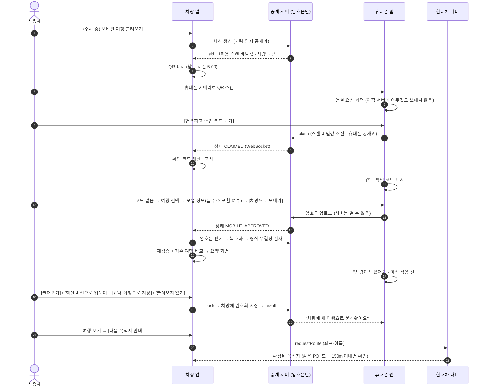

# 01 사용자 흐름 — QR로 모바일 여행 불러오기

> 떠날지도의 여행은 휴대폰(모바일 웹)에서 만들고, 차량(Pleos Connect 앱)은 그 여행을 **한 번 가져와** 다시 검사하고 안내합니다. 이 문서는 명세 24-1·24-4·24-5·24-6의 흐름을 실제 구현 화면 기준으로 정리합니다.

## 1. 기본 흐름 (11단계)

QR만 스캔해서는 아무 일도 일어나지 않습니다. 휴대폰에서 "연결" 버튼을 눌러야 서버에 연결 요청이 가고, 여행 데이터는 사용자가 하나를 골라 승인해야만 암호화되어 전송됩니다. 영구 계정·기기 연결은 만들지 않습니다.

## 2. 사람이 확인하는 네 관문

| 관문 | 어디서 | 무엇을 확인 | 구현 |
|---|---|---|---|
| ① 연결 | 휴대폰 | 이 QR로 연결할지 | `/c` 연결 요청 화면의 [연결하고 확인 코드 보기] — 링크를 연 것만으로는 claim하지 않음 |
| ② 대상 | 휴대폰·차량 | 두 화면의 6자리 코드가 같은지 | ECDH에서 유도한 코드. 서버가 조작해도 일치시킬 수 없음 |
| ③ 전송 승인 | 휴대폰 | 어떤 여행을, 집 주소 포함 여부까지 | 여행 선택 → 보낼 정보 → 보내기 전 확인 |
| ④ 불러오기 승인 | 차량 | 요약·재검증 결과를 보고 적용할지 | 요약 화면의 결정표 버튼 |

## 3. 화면 목록과 문구

### 차량 (Pleos Connect)

| 상태 | 화면 문구 (발췌) | 버튼 |
|---|---|---|
| 진입 | 떠날지도 · 휴대폰에서 만든 여행을 차에서 이어 가요 | 모바일 여행 불러오기 (주행 중: "주차 중에만 사용", 비활성) |
| QR 표시 | 1. 휴대폰 카메라로 QR을 스캔하세요 / 2. 휴대폰에 뜨는 6자리 코드를 이 화면과 비교하세요 / 3. 휴대폰에서 여행을 골라 보내면, 여기서 한 번 더 승인해요 / 남은 시간 4:58 / QR에는 여행·개인정보가 없어요 · 5분 동안 한 번만 쓸 수 있어요 | 취소 |
| 휴대폰 연결됨 | 휴대폰이 연결됐어요 · 확인 코드 482 913 · 휴대폰에서 여행을 골라 보내 주세요 | 내 휴대폰이 아니에요 · 취소 |
| 수신 중 | 휴대폰에서 보낸 여행을 받는 중이에요 | — |
| 요약·승인 | 받은 여행 확인 · 코드 482 913 / 이름(v번호) / 기간·박수 / 장소·고정 일정·숙박·미배정 개수 / 첫날 기준·출발·귀가·집 주소 포함 여부 / 다시 확인한 결과(충돌·확인 필요) / 결정표 문구 | 결정표에 따른 버튼 |
| 저장 중 | 차량에 저장하는 중이에요 | — |
| 완료 | 새 여행으로 불러왔어요 등 결과별 문구 | 여행 보기 · 닫기 |
| 만료 | QR 유효시간이 지났어요 / 승인 시간이 지나 불러오지 않았어요 | 새 QR 받기 · 닫기 |
| 취소 | 휴대폰에서 연결을 취소했어요 / 잘못된 연결 시도가 반복되어 보안을 위해 중단했어요 | 새 QR 받기 |
| 실패 | 인터넷에 연결할 수 없어요 / 여행 형식이 올바르지 않아 불러오지 않았어요 / 휴대폰의 여행 형식이 더 새 버전이에요 · 차량 앱 업데이트가 필요해요 / 차량에 저장하지 못했어요 · 원래 여행은 그대로예요 | 새 QR 받기 |
| 주행 중 | 주행 중에는 사용할 수 없어요 · 주차하면 이어서 진행해요 | — (QR·요약 숨김, 세션은 유지) |

### 휴대폰 (모바일 웹 `/c`)

| 단계 | 화면 문구 (발췌) | 버튼 |
|---|---|---|
| 연결 요청 | 차량 연결 요청 · 이 연결은 여행 하나를 한 번 보내는 데만 쓰이고, 계정이나 기기 연결이 남지 않아요 | 연결하고 확인 코드 보기 |
| 코드 확인 | 확인 코드를 비교해 주세요 · 다르면 다른 차량이나 잘못된 연결일 수 있어요 | 달라요 · 취소 / 같아요 |
| 여행 선택 | 차량으로 보낼 여행 · 하나만 골라요 | 샘플 여행 추가 · 새 여행 만들기 · 다음 |
| 보낼 정보 | 집 주소 포함 (기본 꺼짐) · 보내는 정보 목록 · 보내지 않는 정보(계정·결제·예약번호·비밀번호·메모, 다른 여행) | 이전 · 다음 |
| 보내기 전 확인 | 여행(v번호) · 기간 · 장소·고정·미배정 · 집 주소 · 연결 대상(확인 코드·차량 앱 버전) | 이전 · 차량으로 보내기 |
| 상태 | 차량으로 보냈어요 · 아직 적용 전 → 차량이 받았어요 · 아직 적용 전 → 차량에 새 여행으로 불러왔어요 (휴대폰에서 보냄 / 차량이 받음 / 차량에 적용 — 세 단계 표시) | 연결 취소 · 상태 새로고침 · 내 여행으로 |

"보냄"과 "적용"은 끝까지 구분합니다. 서버에 올라간 것만으로 완료라고 표시하지 않고, 차량이 결과를 보고한 뒤에만 "적용"을 보여 줍니다. "동기화"라는 말은 쓰지 않습니다.

## 4. 기존 여행이 있을 때 (결정표)

차량은 여행마다 `원본 여행 ID · 버전(revision) · 계획 해시`를 저장하고, 들어온 여행과 비교합니다. 자동 병합이나 확인 없는 덮어쓰기는 하지 않습니다.

| 차량 상태 | 차량 문구 | 선택지 | 휴대폰 결과 |
|---|---|---|---|
| 같은 여행 없음 | 새 여행이에요 | 불러오기 · 불러오지 않기 | 새 여행으로 불러왔어요 |
| 같은 버전·같은 내용 | 이미 불러온 여행과 같아요 · 바뀐 것은 없어요 | 확인 (아무것도 쓰지 않음) | 차량에 이미 같은 버전이 있어요 |
| 더 새 버전 | 차량에 있는 같은 여행(v1)의 새 버전이에요 + 변경 요약 3줄 | 최신 버전으로 업데이트 · 새 여행으로 저장 · 불러오지 않기 | 최신 버전으로 바꿨어요 / 사본으로 저장했어요 |
| 더 옛 버전 | 차량에 더 최신 버전(v9)이 있어요 · 덮어쓰지 않아요 | 새 여행으로 저장 · 불러오지 않기 | — |
| 같은 버전·다른 내용 | 같은 버전 번호인데 내용이 달라요 · 덮어쓰지 않아요 | 새 여행으로 저장 · 불러오지 않기 | — |

- 같은 요청이 반복되어도 여행이 늘지 않습니다 (에뮬레이터 E2E: 재전송 전후 1 → 1).
- 집 주소 포함 여부만 다른 재전송은 "같은 버전"으로 봅니다 (계획 해시에서 집 주소 제외).
- 업데이트해도 차량에서 확인한 내비 장소 연결, 방문 기록, 내비 '집'은 유지하고, 사라졌거나 150m 넘게 옮겨진 장소의 연결만 해제합니다.
- "새 여행으로 저장"은 원본과 연결이 끊긴 사본("(사본)")으로 저장되어 이후 비교 대상이 되지 않습니다.

## 5. 예외와 복구

| 상황 | 휴대폰 | 차량 | 근거 |
|---|---|---|---|
| QR 만료 (5분) | 시간이 지난 QR이에요 · 새 QR을 받아 다시 스캔 | QR 유효시간이 지났어요 · [새 QR 받기] (이전 세션 취소 후 새 세션) | 서버 알람 + 차량 로컬 카운트다운 |
| 이미 쓴 QR 재스캔 / 두 번째 휴대폰 | 이미 사용된 QR이에요 | 변화 없음 | claim은 1회, 409 |
| 잘못된 비밀값 5회 | — | 잘못된 연결 시도가 반복되어 보안을 위해 중단했어요 | CANCELLED(SECURITY) |
| 만료 후 승인 | 승인 시간이 지났어요 · 새 QR | 승인 시간이 지나 불러오지 않았어요 | 410 |
| 휴대폰 네트워크 끊김 | 인터넷 연결을 확인한 뒤 다시 시도해 주세요 · 같은 암호문을 다시 보냄 | — | 업로드 재전송은 같은 내용이면 200 |
| 휴대폰 탭 닫힘·새로고침 | 같은 QR을 다시 스캔하면 이어서 진행 (IndexedDB의 연결 기록) | — | 스캔 전 새로고침은 비밀값이 없어 다시 스캔 요청 |
| 차량 네트워크 끊김 | — | 인터넷 연결을 다시 시도하는 중이에요 · 카운트다운 계속 | WebSocket 재연결 + 5초 스냅샷 |
| 차량 앱 종료 | — | 재시작 시 서버 상태를 보고 이어서 진행 (세션 키는 Keystore로 암호화 보관) | `SessionStore` |
| 차량 저장 후 결과 보고 전 종료 | 확인 대기 → 재시작 시 보고 | 보류 중인 결과를 다시 보냄. 다시 적용돼도 결정표 때문에 중복되지 않음 | `PendingResult` |
| 차량 저장 중 휴대폰 취소 | 차량에서 이미 저장하는 중이라 취소할 수 없어요 | 저장 계속 | lock 이후 모바일 취소 409 |
| 적용 확인 전 서버 만료 | 차량 적용 여부를 확인하지 못했어요 · 차량 화면에서 확인 | 늦은 결과 보고로 "적용됨"으로 갱신 | UNCONFIRMED → APPLIED |
| 장소 검색을 쓸 수 없음 (카카오 키 없음·장애) | 'OO' 이름으로 추가 (좌표 없이) | 안내 시 '위치가 계획에 없어 내비에서 찾아요' → 내비 검색 → 고른 곳 확인 후 연결 | 좌표 선택 입력 |
| 장소를 내비에서 못 찾음 | — | 안내를 확인하지 못했어요 · [내비에서 찾기] → 돌아오면 거리로 판정(150m 자동 연결, 2km까지 확인, 그 이상 경고) | `PlaceMatch` |

인터넷이 필요합니다. QR만으로 오프라인 전송이 된다고 안내하지 않습니다.

## 6. 주행 중 동작

- QR 표시·여행 불러오기·내비 안내 요청은 **주차 중에만** 합니다. Pleos 지역별 주행 규제표에서 "QR 로그인"은 모든 지역 주행 중 제한입니다.
- 주행이 시작되면 QR 컴포저블과 요약 화면을 화면에서 제거하고 "주차하면 이어서 진행해요"만 보여 줍니다. 세션과 카운트다운은 그대로 유지합니다 (E2E: 주행 시 QR 해독 불가 확인, 주차 후 같은 세션 재표시 확인).
- 주행 중에는 휴대폰을 꺼내라는 안내나 알림을 보내지 않습니다.
- 주행 상태를 알 수 없으면 잠금으로 처리합니다.

## 7. 불러오기 ≠ 동기화 (24-5)

기본 기능은 "선택한 여행의 현재 버전을 차량으로 가져오기"입니다. 휴대폰에서 여행을 고쳐도 차량은 자동으로 바뀌지 않으며, 다시 QR로 보내면 결정표에 따라 업데이트 여부를 묻습니다. 지속 동기화는 구현하지 않았고, 설계는 [02 기술 구조 · 향후 설계](02_기술_구조.md#9-향후-설계-지속-동기화-미구현)에 따로 적었습니다.

## 8. 24-7 검수 기준 대응

| 검수 기준 | 결과 | 증거 |
|---|---|---|
| 차량에 표시한 QR을 모바일에서 스캔할 수 있는가 | 에뮬레이터 화면 캡처에서 QR 해독 성공. **실제 폰 카메라 스캔은 미시험** | `tools/e2e-car.mts` · `docs/evidence/m4/02-qr.png` |
| 사용자가 전송할 여행을 직접 선택하는가 | 예 | `docs/evidence/m3/03-pick.png` |
| 모바일 전송 승인과 차량 불러오기 승인이 구분되는가 | 예. 휴대폰은 차량 승인 전 "아직 적용 전" | E2E 단계 확인 |
| 다일 여행의 일차·시간·숙소·고정 일정이 유지되는가 | 예 (4일·숙소 3박·고정 2개) | `tools/e2e-mobile.mts` |
| 집 주소 등 민감정보 전송 범위를 알리는가 | 예. 기본 미포함, 목록 표시 | `docs/evidence/m3/04-consent.png` |
| 만료되거나 이미 사용한 QR을 재사용할 수 없는가 | 예 (409/410) | worker 시험 · E2E |
| 중복 요청으로 일정이 여러 개 생성되지 않는가 | 예 (1 → 1) | `tools/e2e-car.mts` |
| 기존 여행을 확인 없이 덮어쓰지 않는가 | 예 (결정표) | `TripRulesTest` |
| 장소 식별 실패와 네트워크 오류를 복구할 수 있는가 | 내비 검색 대체·재시도 구현. 네트워크 복구는 단위·서버 시험 | `PlaceMatchTest` · worker 시험 |
| 불러온 다음 목적지를 실제 현대차 내비게이션으로 전달하는가 | 예. 에뮬레이터의 Pleos 내비가 경로 안내 시작, 앱이 내비 응답으로 확인 | `docs/evidence/m5/` |
