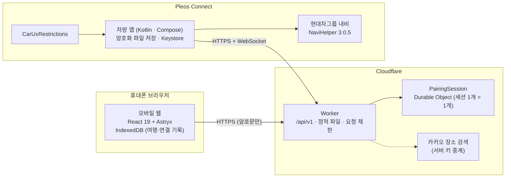
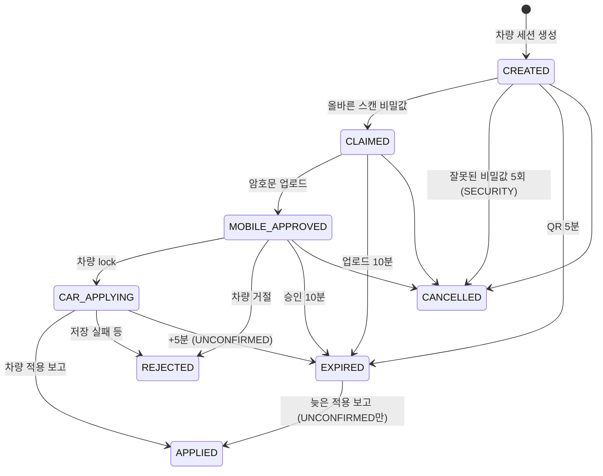
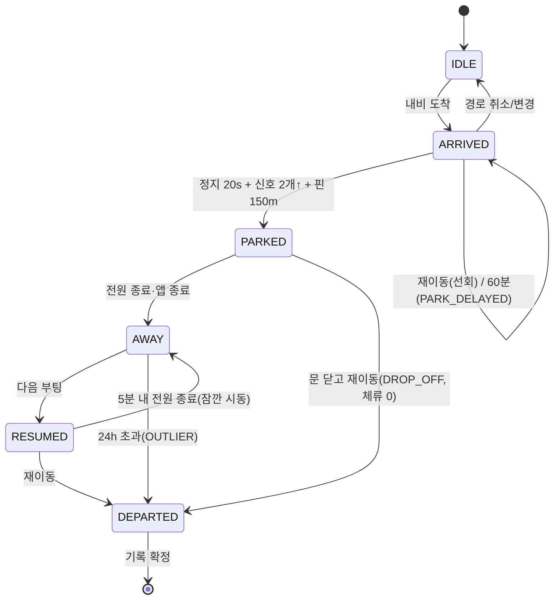

# 02 기술 구조

## 1. 구성



| 경로 | 내용 |
|---|---|
| `schema/` | 언어 중립 계약: `trip-transfer.v1.schema.json`(zod에서 생성), `pairing-protocol.v1.json`(상태·유효시간·오류 코드), fixture 22개, 암호화 벡터 |
| `packages/shared` | 전송 스키마(zod), 정규화 JSON·해시, 무결성 검사, WebCrypto E2E, 세션 상태 전이(순수 함수), 샘플 여행 |
| `packages/worker` | Worker 라우터, `PairingSession` DO, 카카오 프록시, 웹 정적 파일 제공 |
| `packages/web` | 여행 편집기, 연결 화면(`/c`), 개인정보 안내 |
| `car/core-trip` | (JVM) 전송 DTO·파서, 정규화 해시, 재검증기, 결정표, 다음 목적지, 장소 판정 |
| `car/core-pairing` | (JVM) E2E 암호화(java.security), 차량 상태 머신 |
| `car/app` | Compose UI, ViewModel, OkHttp 클라이언트, 저장소, 주행 잠금, 내비 게이트웨이 |

## 2. 연결 프로토콜

### QR 내용

```
https://<host>/c#v1.<sid>.<scanSecret>.<fp>
```

- `sid`, `scanSecret`: 각각 128bit 난수(base64url 22자). `fp`: 차량 임시 공개키 SHA-256의 앞 16바이트.
- 모두 **fragment(`#` 뒤)**에 있어 브라우저가 서버로 보내지 않습니다. 웹은 읽자마자 `history.replaceState`로 주소창·기록에서 지웁니다.
- 여행·주소·비밀번호·장기 토큰은 들어 있지 않습니다. URL은 약 115바이트, QR 버전 7(ECC M)입니다.

### API (`/api/v1`, 토큰은 Authorization 헤더로만)

| 요청 | 호출자 | 역할 | 반복 호출 |
|---|---|---|---|
| `POST /sessions` | 차량 | 세션 생성 (`carPub`, 앱 버전, 지원 스키마 버전) → `sid`, `scanSecret`, `carToken`, 만료 시각 | — |
| `GET /sessions/{sid}/events` | 차량 | WebSocket 상태 푸시 (hibernation, 연결 1개) | 재연결 시 이전 연결 종료 |
| `GET /sessions/{sid}` | 차량 | 상태 스냅샷 | 안전 |
| `POST /sessions/{sid}/claim` | 휴대폰 | 스캔 비밀값 소진 + 휴대폰 공개키 등록 → `mobileToken`, `carPub` | 2회차부터 409 |
| `PUT /sessions/{sid}/payload` | 휴대폰 | 암호문 업로드 (최대 96 KiB) | 같은 내용 200, 다른 내용 409 |
| `GET /sessions/{sid}/payload` | 차량 | 암호문 받기 | 안전 |
| `POST /sessions/{sid}/lock` | 차량 | 적용 시작 (이후 휴대폰 취소 불가) | 안전 |
| `POST /sessions/{sid}/result` | 차량 | 결과 보고 (`APPLIED`/`REJECTED` + 결과 코드) | 같은 결과 안전 |
| `POST /sessions/{sid}/cancel` | 양쪽 | 취소 | 안전 |
| `GET /sessions/{sid}/status` | 휴대폰 | 상태 조회 | 안전 |
| `POST /places/search` | 휴대폰 | 카카오 장소 검색 (검색어는 본문 `{q}`로 보내 URL·로그에 남지 않음; 키 없으면 503 → 직접 입력) | — |
| `POST /routes/durations` | 휴대폰 | 카카오모빌리티 길찾기로 구간별 운전 시간·추천 경로 거리(M32, 거리 M36): 본문 `{points:[{latE7,lonE7}…]}`(2–25개, 한 날의 연속 구간) → `{minutes:[…], meters:[…]}`. 같은 지점(30m 이내)은 0분·0m로 처리하고 요청에서 뺌. 휴대폰은 빈 구간을 자동으로 채우고(여행을 열 때 한 번, 경로가 바뀐 뒤), 당겨서 새로고침·'이동시간·거리 다시 계산'이면 모든 구간을 다시 물어 시간을 덮어씀. 설정에 집 주소가 있으면 집 → 첫 장소, 마지막 장소 → 집 구간도 집 좌표로 계산(M39, 구간 키 `@home>…`). 거리는 여행 문서의 `legMeters`(구간 키 → m, 휴대폰 전용)에만 저장. 저장·로그 없음, 레이트리밋 `RL_ROUTE` 30/분, 키 없거나 거절 시 503/502 → 빈 구간은 그대로 | — |
| `POST /routes/paths` | 휴대폰 | 일차 지도에 그릴 실제 도로 경로(M54): 본문은 durations와 같음 → `{paths:[…]}`(구간마다 `[latE5, lonE5, …]` 정수 배열, 같은 지점은 `[]`, 경로 없음은 `null`). 카카오 `sections[].roads[].vertexes`를 이어 붙여 Douglas–Peucker(5m, 구간당 최대 1500점)로 줄임. 휴대폰은 같은 정류지 묶음을 세션에서 한 번만 묻고 메모리에만 둠(여행 문서·전송에 없음). 저장·로그 없음, `RL_ROUTE` 공유 | — |
| `POST /fleet/webhook` | Pleos Fleet | Fleet API 웹훅 수신(M57, 주기 데이터·차량 이벤트). **`FLEET_WEBHOOK_TOKEN`이 없으면 404(운영 기본값)**. 있으면 `Authorization: Bearer`(웹훅의 Custom Header)를 확인하고, 문서의 payload를 검사해 차량별 최신 상태만 `FleetVehicle` Durable Object에 둠(VIN·위치 미저장, 24시간 뒤 삭제). 응답 본문은 Fleet 문서의 callback response 형식 | 같은 내용 반복 안전 |
| `GET /fleet/vehicles/{vehicleId}/readiness?km=` | 운영사 | 받은 상태 × 여행 거리 → `READY`/`CAUTION`/`STOP`과 항목 목록(M57, 같은 토큰). 상태가 없으면 404 | 안전 |
| `POST /places/resolve` | 휴대폰 | 공유 링크(naver.me·kko.to 등) 해석: 서버가 **허용 도메인만** 가져와 `og:title`/`og:description`로 장소명·주소를 읽어 반환(좌표는 검색으로 확정). URL은 본문, 저장·로그 없음 | — |

### 상태 전이 (`packages/shared/src/protocol.ts` `transition`)



- 종료 상태가 되면 암호문과 비밀값 해시를 즉시 지우고, 상태·결과·시각만 남긴 묘비를 10분 뒤 `deleteAll`로 지웁니다.
- 유효시간은 서버 상수이며 시험에서는 1초로 줄여 실제 시간으로 만료를 확인합니다.
- Durable Object는 한 번에 요청 하나만 처리하므로 1회 claim과 상태 전이가 원자적입니다.
- 네트워크 재시도에 강합니다: 같은 휴대폰(같은 `mobilePub`)이 `CLAIMED` 세션을 다시 claim하면 새 토큰을 재발급하고, 같은 암호문을 다시 업로드하거나 같은 결과를 다시 보고해도 상태가 바뀌지 않습니다(멱등). 업로드 전까지 스캔 비밀값 해시는 유지됩니다.

### 인증·암호화·확인 코드

| 항목 | 방식 |
|---|---|
| 차량 인증 | 생성 시 받은 `carToken`(256bit). 서버는 SHA-256만 저장, 상수 시간 비교 |
| 휴대폰 인증 | claim 성공 시 `mobileToken`(256bit). 세션당 휴대폰 1대 |
| 차량 키 검증 | 휴대폰이 claim 응답의 `carPub` 지문을 QR의 `fp`와 비교 → 다르면 "연결 대상이 일치하지 않아요" |
| 종단간 암호화 | P-256 ECDH → HKDF-SHA256(salt = SHA-256("handoff/v1\|"+sid), info = 라벨‖0‖carPub‖mobilePub) → AES-256-GCM. AAD에 sid·스키마 버전 포함 |
| 확인 코드 | 같은 ECDH 결과에서 HKDF("confirm")로 4바이트 → 10⁶으로 나눈 나머지 6자리. 서버가 키를 바꿔치기하면 두 화면 코드가 달라짐 |
| 교차 검증 | `schema/fixtures/crypto/vectors.json`의 고정 키로 TS·Kotlin이 같은 공유 비밀·키·코드·암호문을 내는지 시험 |

X25519 대신 P-256을 쓴 이유: Android minSdk 28에서 추가 라이브러리 없이 지원되고, 브라우저 WebCrypto도 모두 지원합니다.

### 요청 제한·전송 보안

- Workers Rate Limiting: IP당 60초에 세션 생성 10, claim 20, 전체 120, 검색 30. 세션별 claim 5회.
- 암호문 상한: 평문 32,768바이트 → 암호화 후 상한 `maxPayloadBytes = 131,200`바이트(스키마·서버·공유 상수가 한 값에서 파생). 초과하면 `PAYLOAD_TOO_LARGE`, 휴대폰은 암호화 전에 크기를 확인합니다.
- TLS 1.2 이상, HSTS. 차량 release 빌드는 평문 통신 금지, dev 빌드만 `10.0.2.2`/`localhost` 평문 허용.
- 로그에는 요청 본문·토큰·검색어를 남기지 않습니다. Workers 관측(observability) 샘플링도 꺼 두어 요청 메타데이터가 수집되지 않습니다(`03_개인정보_설계.md`의 "IP 미보관"과 일치).

## 3. 여행 전송 스키마 v1

zod 스키마(`packages/shared/src/tripTransfer.ts`)가 기준이며 JSON Schema는 생성물입니다. 모든 객체는 `additionalProperties: false`이고, 메모·예약번호·결제·비밀번호 칸은 아예 없습니다.

| 영역 | 필드 |
|---|---|
| 식별 | `tripId`(UUID, 불변), `revision`(내용이 바뀔 때만 +1), `updatedAt` |
| 기본 | `name`, `timezone`(IANA), `startDate`, `endDate` |
| 출발·귀가 | `firstDay`(DEPART_ORIGIN+출발시각 — **null 허용**(M48: 출발 시각은 첫날 포함 모든 날 선택 사항, 없으면 그날 도착 시각은 미정·`DEPARTURE_UNKNOWN`) \| ARRIVE_FIRST_STOP+도착시각+준비분), `origin`(HOME \| PLACE \| CURRENT — M59: CURRENT는 '출발할 때 차가 있는 곳'으로 좌표가 없고, 출발 장소를 고르지 않은 여행의 기본값), `finalDestination`(HOME \| PLACE, CURRENT는 스키마 오류), `home`(동의할 때만). 2일차부터의 출발지는 따로 보내지 않고 전날 `lodgingPlaceRef`가 출발지 |
| 장소 | `placeRef`, 이름, 주소, `latE7`/`lonE7`(정수, **둘 다 있거나 둘 다 null** — 검색 없이 이름으로 추가한 장소), 종류, 출처(KAKAO/MANUAL+외부ID), `naviPoi?`, 영업시간(UNKNOWN \| ALWAYS_OPEN — M59: 호수·해변·거리처럼 영업시간이 따로 없는 곳 \| USER_ENTERED — 요일별 여닫는 시각(하루 두 구간이면 사이가 쉬는 시간)·특정 휴무일) |
| 방문 | 체류 분, 준비 분(`prepMinutes`, 전송 호환을 위해 칸만 유지 — 시각표에서는 쓰지 않음, M42), 중요도, 희망시각, 고정(시각·종류), 날짜/시간 변경 허용, `unassignedReason`(미배정 사유) |
| 일차 | `dayIndex`, `date`, `departTime`(null 허용), `endBy`, `visitOrder`, `legs`(구간 n+1개, null은 미확인), `lodgingPlaceRef` |

- **정규화 해시**: 키를 UTF-16 순으로 정렬, 공백 없음, 정수만, 문자열은 `JSON.stringify`와 같은 이스케이프 → SHA-256 base64url. Kotlin(`CanonicalJson.kt`)이 한글·이모지·제어문자·짝 없는 서로게이트까지 같은 값을 내는지 fixture로 확인합니다.
- **무결성 오류 코드**(이것만 거절 사유): `SCHEMA`, `UNSUPPORTED_VERSION`, `DATE_RANGE`, `DAY_COUNT_MISMATCH`, `DAY_SEQUENCE`, `DUPLICATE_REF`, `UNKNOWN_PLACE_REF`, `UNKNOWN_VISIT_REF`, `DUPLICATE_ASSIGNMENT`, `LEGS_LENGTH`, `UNASSIGNED_REASON_MISMATCH`, `HASH_MISMATCH`, `TOO_LARGE`. 검사 순서까지 계약이며 TS·Kotlin이 fixture 22개에서 같은 첫 코드를 냅니다.
- **버전 협상**: 차량이 세션 생성 때 지원 버전을 알리고, 서버는 지원하지 않는 버전 업로드를 거절합니다(422). 휴대폰은 "차량 앱 업데이트가 필요해요"를 보여 줍니다.

## 4. 차량 앱

### 저장

- `filesDir/{real|demo}/trips/<localId>.trip` — 여행 하나당 파일 하나, `AtomicFile`로 쓰고 Android Keystore AES-256-GCM 키로 암호화(`SecureBox`).
- 읽을 수 없는 파일은 지우거나 덮지 않고 개수만 알립니다.
- `allowBackup=false`, 데이터 추출 규칙에서 파일·환경설정 모두 제외.
- 실제 데이터와 시연 데이터는 폴더가 다릅니다.
- `LocalTrip` = 받은 계획(수정하지 않음) + `CarOverlay` + `ImportMeta`(원본 ID, 버전, 계획 해시).
- `CarOverlay`: 내비 장소 연결, 내비 '집', 출발지 재지정(여기서 출발 — 1일차와 전날 숙소가 없는 날만, `DayStart.canDepartHere`), 방문 기록과 시각(`visitedAt`: 수동·내비 도착·시연 신호), 건너뛴 정류장(`skipped`), 내비 예상 이동시간(`legEstimates`, 키 "출발>도착"), 지금 내비에 넘긴 대상(`guiding`).
- 새 필드는 모두 기본값이 있어 이전 버전이 저장한 파일을 그대로 읽습니다(`OverlayCompat` 시험). 반대로 이전 APK는 새 파일을 읽지 못하므로(`ignoreUnknownKeys=false`) 다운그레이드는 지원하지 않습니다.
- 여행 파일 쓰기는 `Container.updateTrip` 한 곳(단일 잠금)으로 모았습니다. 화면과 도착 추적기가 함께 쓰기 때문입니다.

### 재검증 (`TripValidator`, 24-4)

결과는 충돌(CONFLICT) / 확인 필요(UNCERTAIN) / 정보(INFO)로 표시만 하고 계획은 고치지 않습니다.

| 규칙 | 판정 |
|---|---|
| 좌표 없음 / 국내 범위 밖 / 같은 장소 중복 | 충돌 / 확인 필요 / 정보 |
| 날짜 없는 고정 일정 | 충돌 |
| 하루 타임라인: 출발 + 이동 → 고정 시각보다 늦으면(주차 시간은 넣지 않음, M42) | 충돌 ("고정 13:00에 늦어요, 예상 13:20") |
| 이동시간 없음 | 확인 필요 ("충돌 확인 불가") — 0분으로 계산하지 않음 |
| 이동시간 출처 | 계획(휴대폰 입력) → 없으면 내비 예상(`requestTrip`) → 없으면 미확인. 내비 예상을 쓴 구간은 정보 "n구간 내비 예상". '여기서 출발' 뒤 1일차 첫 구간은 집 기준 입력값 대신 새 출발지의 내비 예상만 씀 |
| 고정 일정 앞 구간 이동시간 없음 | 확인 필요 |
| 영업정보 모름(UNKNOWN, 숙소 제외) | 확인 필요 ("영업정보 미확인 N곳"). 영업시간이 따로 없는 곳(ALWAYS_OPEN)은 세지 않음 |
| 사용자 입력 영업시간: 휴무일·요일·시간대 | 충돌 ("사용자 입력 기준") |
| 1~N−1박 숙소 없음 | 확인 필요 (다음 날 출발지를 알 수 없음) |
| 첫날 도착 기준: 첫 구간 이동시간 없음 / 전날 출발 필요 | 확인 필요 / 충돌 |
| 집 출발·귀가인데 집 위치 없음 | 확인 필요 (내비 '집' 불러오기 제공) |
| 이름만 있는 장소(좌표 없음) | 확인 필요 — 안내를 누르면 바로 내비 검색으로 찾고, 사용자가 확인한 내비 장소를 연결 |
| 목표 귀가 시각(`endBy`) 초과 | 충돌 |
| 지난 여행 (여행 시간대 기준 오늘) | 정보 ("렌터카·공용 차량이면 삭제") |

### 가져오기 상태 머신 (`CarHandoffMachine`)

순수 리듀서 `(상태, 이벤트) → (상태, 효과)`이고 ViewModel이 효과(세션 생성, 코드 계산, 암호문 받기, 저장, 결과 보고, 취소, 연결 해제)를 실행합니다. 주요 규칙:

- 차량 승인(Approve) 없이는 저장하지 않습니다.
- 요약 단계의 "불러오지 않기"는 취소가 아니라 답입니다(`REJECTED/USER_DECLINED`). 휴대폰은 "차량에서 불러오기를 취소했어요"를 봅니다.
- 저장(커밋) 중에는 서버의 만료·취소 푸시가 끼어들지 못합니다. 결과는 먼저 파일로 남긴 뒤 보내고, 실패하면 다음 실행 때 다시 보냅니다.
- 카운트다운은 서버가 알려 준 남은 시간과 단조 시계로 계산합니다(차량 시계가 틀려도 영향 없음).

### 다음 목적지 안내 (24-1 11단계)

1. 오늘 날짜(여행 시간대 기준)의 일차에서 방문하지 않은 첫 장소 → 없으면 그날 숙소 → 마지막 날은 귀가지.
2. 내비가 이미 다른 곳으로 안내 중이면 "현재 경로를 바꿀까요?"를 먼저 묻습니다.
3. `NaviHelper.requestRoute(RouteInfo(좌표, 이름, poiId?, 주소, provider?))`.
4. 내비는 처음에 빈 목적지를 보낸 뒤 경로 화면을 거쳐 확정합니다. 앱은 최대 30초 동안 목적지를 다시 조회해 **같은 POI이거나 150m 이내**일 때만 "안내를 시작했어요"를 표시하고, 그 내비 장소를 오버레이에 연결해 둡니다.
5. 다른 곳이 확정되면 거리를 보여 주고 사용자가 고르게 합니다. 응답이 없으면 [내비에서 찾기](`SearchPlace("이름 시·군")`) → 앱으로 돌아왔을 때 거리로 판정(150m 자동, 2km까지 확인, 그 이상 경고).
6. 카카오·수동 ID는 내비 `poiId`로 쓰지 않습니다. 요청은 사용자가 버튼을 눌렀을 때만 보냅니다(실제 목적지를 바꾸기 때문).

에뮬레이터(Pleos Connect 2.1.0)에서 확인한 사실:
- 좌표와 이름만 담은 `RouteInfo`로 실제 경로 안내가 시작됩니다.
- 확정 응답은 `poiId`·`poiProvider`가 빈 값이고 좌표와 이름은 들어 있습니다.
- HOME 즐겨찾기는 조회되지만 주소·이름이 빈 값일 수 있습니다. 이 경우 화면에는 "내비 즐겨찾기 '집'"으로 표시합니다.

### 오늘 경로 묶음 전송 (M11)

- '오늘 경로 전송'은 당일 남은 스톱(미룬 것은 뒤로, 좌표 있는 것만)의 **다음 3스톱**을 한 번에 내비로 보냅니다: 마지막이 목적지, 앞의 둘이 경유지(`NaviHelper.requestRouteWithWaypoints(RouteWithWaypointsRequest(RouteInfo, [RequestWaypointInfo(..., WaypointIndex.FIRST/SECOND)]))`).
- 내비가 받는 경유지는 **최대 2개**(`WaypointIndex` = FIRST/SECOND/ALL)이므로 한 번에 3스톱이 상한입니다. 그 이상은 이 전송에서 빠지고, 도착·정밀 ETA가 필요하면 기존 '다음 목적지 안내'(단일)를 씁니다. 확정 판정은 `route()`와 같은 `confirmRoute`(최종 목적지 기준)를 공유합니다.
- 실제 경로를 바꾸므로 **주차 중 명시적 탭에서만** 보냅니다(기존 규칙).
- **보낸 경로 따라가기(M57, `TodayRoute`)**: 확정되면 보낸 스톱을 운전 순서대로 `CarOverlay.guidingStops`에 적어 둡니다(마지막이 내비 목적지 = `guiding`). 이후
  - `getWaypointInfo`로 내비가 실제로 담은 경유지 수를 확인해, 보낸 것보다 적으면 "3곳 중 2곳만 올라갔어요"라고 알립니다.
  - `onWayPointArrived`가 오면 이름이 같거나 현재 위치가 150m 안인 경유지 스톱을 방문함으로 표시합니다(마지막 스톱은 기존처럼 `onDestinationArrived`). 맞는 스톱이 없으면 무시합니다.
  - 시간 지킴이는 다음 스톱이 경로의 다음 경유지일 때 **그 경유지의 남은 시간**(`onDrivingInfo.waypoints`, 정차 중에는 `getWaypointInfo`)을 씁니다. 이름으로 찾고, 이름이 다르면 내비 목록의 개수가 남은 경유지 수와 같을 때만 순서로 맞춥니다. 맞출 수 없으면 계획의 구간 시간으로 돌아갑니다.
  - 내비가 보낸 경로의 마지막 스톱으로 안내 중이면 "내비가 다른 곳으로 안내 중"이라고 하지 않습니다. [다음 목적지 안내](한 곳)를 다시 누르면 이 목록은 비웁니다.
- 계정 기반 '다음 시동 때 자동으로 뜨는 사전 전송'은 지속 연결·서버 보관이 필요해 개인정보 원칙과 충돌하고 Pleos에도 해당 API가 없어 **구현하지 않습니다**. 이 묶음 전송이 '미리 짠 경로를 내비로'의 실제 demonstrable 형태입니다.

### 시간 지킴이 (`LiveProjection`)

여행 당일(여행 시간대 기준)에는 남은 일정을 지금 시각부터 다시 계산합니다.
- 첫 구간: 내비가 같은 장소로 안내 중이면 내비의 남은 시간(`onRouteStarted`·`onDrivingInfo`·`getDestinationInfo`, 단위 초) → 아니면 '여기서 출발' 예상 → 아니면 계획 구간.
- 나머지: 계획의 타임라인 규칙(`walk`)을 그대로 씁니다. 고정 시각이 사슬을 다시 잇고, 이동시간이 없으면 끊깁니다.
- 판정: 다음 고정 일정(없으면 그날 귀가 목표 `endBy`)까지 여유가 10분 초과면 여유, 0~10분이면 빠듯, 음수면 늦음, 계산할 수 없으면 확인 불가. 10분은 우리가 정한 기준입니다.
- 늦음일 때만, 늦는 기준이 고정 일정이면 그 앞의, 귀가·숙소 도착 시각(endBy)이면 마지막 고정 일정 뒤의 **선택(OPTIONAL)** 정류장 가운데 지연을 덮는 가장 작은 하나를 건너뛰기로 제안합니다(고정 일정 앞을 건너뛰어도 그 시각에 다시 맞춰져 endBy는 당겨지지 않음, M37). 절약 시간은 체류만 셉니다(주차 시간은 넣지 않고, 줄어드는 이동시간도 세지 않아 보수적, M42). 꼭·보통·고정 일정은 제안하지 않습니다.
- 건너뛴 정류장을 지나는 구간은 앞뒤 구간의 합(상한값)으로 계산하고 '대략'으로 표시합니다. 따라서 '늦음'은 과대 경보일 수 있지만 '여유'는 안전한 쪽입니다.
- **미루기(뒤로 미루기)**: 같은 후보를 '건너뛰기'(삭제) 대신 '뒤로 미루기'(그날 tail로 이동)로도 제안합니다(`DeferSuggestion`). 미룬 정류장은 계획을 바꾸지 않고 `CarOverlay.deferred`에만 기록되며, `remaining`을 tail로 안정 재배치합니다. 고정 일정 앞에서 빠지므로 예약에 맞추는 효과는 건너뛰기와 같지만 그 정류장은 나중에 방문합니다. 미룬 구간은 계획 레그가 없어 그 정류장 이후 시각은 '확인 필요'로 둡니다. `deferred`가 비면 기존 동작과 동일합니다(교차검증 불변). **다른 날로 미루기**는 `CarOverlay.deferredTo`(visitId→일차)로, 원래 날에서 빼고 대상 날 tail에 주입하며(계획 레그가 없어 '확인 필요') 마찬가지로 계획을 바꾸지 않습니다.

### 자동 도착 (`GuidanceTracker`, `ArrivalRule`)

- 안내가 확정되면 그 대상(일차·정류장·내비가 확정한 이름·좌표)을 `guiding`에 저장합니다.
- 앱 범위의 추적기가 `onDestinationArrived`를 받아, 이름이 확정 이름과 같거나 현재 위치가 150m 이내면 그 정류장을 방문함으로 표시합니다(도착 이벤트에는 좌표가 없음). 숙소·귀가지 도착은 `guiding`만 지웁니다.
- 설정 '도착 자동 표시'(기본 켬)를 따르고, 화면에 [도착 되돌리기]를 둡니다. 내비 이벤트를 놓쳐도 수동 '도착 처리'는 그대로 있습니다.
- 에뮬레이터 내비는 자체 측위를 써서 움직이지 않으므로(사전 확인 S4), 에뮬레이터 전용 '도착 신호(시연)'로 같은 경로를 시험하고 화면에 '시연 신호'로 표시합니다.

### 주차·체류 측정 (`VisitTracker`, `visit/`) — 뼈대만 보관, 현재 결과물에는 미반영 (M42)

**지금 결과물은 주차 시간을 어디에도 반영하지 않습니다.** 휴대폰의 '주차·입장 준비(분)' 입력칸을 없앴고, 휴대폰·차량 시각표는 도착 시각을 그대로 시작 시각으로 씁니다(`prepMinutes`는 전송 호환을 위해 칸만 남음). 차량 화면의 '차량 신호: 주차' 배지와 시연용 '체류 측정 예시'도 없앴고, 시간 지킴이는 주차 여유·체류 경향을 더하지 않습니다. 아래 상태 머신·통계(`Visit.kt`·`VisitStats.kt`·`VisitCollector.kt`·`VehicleSignals.kt`)와 그 시험은 **§10 실제 주차 시간 추정**의 뼈대로만 보관하며, 실제 차량 신호에 연결되어 있지 않습니다.

원래 설계: 내비 도착 신호와 조회 전용 차량 신호로 **주차 시간**(도착→차 세우고 내림)과 **체류 시간**(주차→시동 끔→다시 켜서 출발)을 측정해, 시각표에 "주차 여유" 슬롯과 체류 경향 보정으로만 반영합니다. 계획은 바꾸지 않습니다.

- **신호(조회 전용)**: 주행거리·주차브레이크·운전석 도어·안전벨트·전원 종료(+기어 P, 차가 노출하면)를 Pleos Vehicle SDK로 **구독만** 합니다(`CONTROL_CAR_*` 미선언). 어댑터는 `VehicleSignals`(인터페이스) ↔ `PleosVehicleSignals`(실 SDK, 2단계) ↔ `FakeVehicleSignals`(시험·에뮬). 미지원·미연결이면 측정을 건너뛰고 앱은 정상 동작합니다.
- **상태 머신** `VisitTracker`(순수 Kotlin, SDK 의존 없음): 내비 도착(`navi.arrivals`를 `GuidanceTracker`와 **별도로** 수집)에서 시작합니다.



- **저장**: 전이 **시점**과 **핀-주차 거리(m)**만. 원시 신호값·좌표는 저장하지 않습니다. `VisitRecord`는 `CarOverlay`에 들어가 **여행을 지우면 함께 삭제**되고, 서버·휴대폰으로 보내지 않습니다. AWAY는 동기 저장(그 직후 프로세스가 죽어도 복구), 24시간 넘은 미확정 기록은 OUTLIER로 확정해 통계에서 제외합니다.
- **수명**: 포그라운드 서비스 없이 **앱 범위**(Container 소유, `GuidanceTracker`와 동일). 앱이 살아 있는 동안 측정하고, 프로세스가 죽으면 AWAY 스냅샷에서 다음 실행에 이어 붙입니다.
- **시각표 반영**: 현재는 **하지 않습니다**(M42). `ParkingBufferPolicy`(유형×주말 기본값 → 같은 유형 3건↑이면 중앙값, 고정 일정 직전 ×1.5≤30분)와 `StayTendency`(실제/계획 체류 중앙값, [0.5,2.0])는 코드로만 남아 있고 `LiveProjection`이 쓰지 않습니다.
- **2단계(실차/실 SDK)**: `PleosVehicleSignals`(callbackFlow·capability 확인·모든 unregister 후 `release()`), 매니페스트 `CAR_DRIVE/CAR_DOORS/CAR_SAFETY`(조회 전용, 제어 권한 없음), 프로브 화면, AAR 시그니처·콜백 스레드·`getGear()` 존재 확인. 이 에뮬레이터는 신호 주입이 막혀 있어(§4 주행 잠금 참고) 실신호는 실차/userdebug에서 검증합니다.

### 내비 예상 이동시간·배터리 (`requestTrip`)

- '여기서 출발'(주차, 탭할 때): `getCurrentLocationInfo`로 위치를 받고 다음 목적지까지 `requestTrip`을 묻습니다. 경로를 바꾸지 않는 조회입니다(사전 확인 S3).
- **1일차 첫 구간 자동 계산**(M60, `TripsViewModel.measureFirstLeg`): 계획에 1일차 첫 구간 시간이 없고(`DayStart.untimed` — 출발지가 '현재 위치'이거나 휴대폰에 집 주소가 없어 카카오로 구하지 못한 경우) 1일차 첫 장소를 아직 방문하지 않았으면, 주차 중 여행 상세를 열 때(여행 전이나 1일차 당일) 같은 두 조회를 탭 없이 합니다. 차가 계획의 출발지(집·장소) 150m 안에 있으면 그 구간('집>첫 장소')의 시간으로 저장하고, 다른 곳이거나 출발지가 '현재 위치'면 출발지를 현재 위치로 잡아(`originPinnedAuto`) 저장합니다. 잡은 출발지는 1일차가 시작될 때까지 차를 따라가며, 차가 150m 넘게 움직였거나 예상이 30분보다 오래되면 다시 묻습니다(`DayStart.needsMeasure`). 손으로 정한 출발지는 그대로 두고, [출발지 되돌리기]를 누르면 그 세션에서는 다시 잡지 않습니다.
- **현대차 내비로 전 구간 측정·순서 최적화**(M63, `NaviPlan.kt` · `TripsViewModel.measure`): 차량에서는 내비가 잰 값이 구간의 시간·거리입니다(`TripValidator.leg`: `legEstimates` 먼저, 없으면 휴대폰 값). `requestTrip`은 차가 있는 곳에서만 재므로, 떨어진 구간은 경유지 경로(`requestRouteWithWaypoints`)를 걸고 내비가 주는 경유지별 남은 시간·거리의 이웃한 차이로 구합니다(`NaviMeasure.chains`가 구간을 경로로 엮고 `legs`가 차이를 냄, 경로당 경유지 9곳). 경로를 걸면 내비가 앞에 나오고 뒤에 있는 앱은 약 10초 뒤 정지되므로 측정 동안 `MeasureService`(shortService 포그라운드 서비스)가 프로세스를 붙잡고, 끝나면 목적지가 있는지 확인한 뒤 경로를 취소합니다(경로 없이 보낸 취소는 에뮬레이터 내비를 '취소 진행 중'에 걸리게 함). 내비가 경유지를 덜 받으면 받은 수만큼으로 경로를 다시 나눕니다. [N일차 순서 최적화]는 그 날의 출발 → 장소 → 도착 사이 모든 구간(n·(n+1)개)을 재고, `RouteOptimizer`가 모든 순서를 비교해 운전이 10분 이상 줄고 그 날의 충돌 수·예약 15분 여유를 해치지 않는 가장 빠른 순서를 제안합니다(휴대폰 '더 빠른 순서'와 같은 기준, 장소 8곳까지, 이미 방문·건너뛰기가 있는 날은 제외). [이 순서로 바꾸기]는 `CarOverlay.orderOverrides`에 순서만 저장하고 계획은 그대로 둡니다 — 화면과 안내는 `LocalTrip.view`(계획 + 차량 순서)를 읽고, 순서가 바뀌어 이웃이 달라진 구간은 계획 값을 버리고 내비 값만 씁니다. 휴대폰이 새 버전을 보내면 차량 순서는 지워집니다. 측정은 주차 중 사용자가 누르고 확인한 뒤에만 하며, 차가 움직이면 멈추고 경로를 지웁니다. 화면은 `docs/evidence/m63`.
- 출발지 규칙(M59, `DayStart`): 1일차는 여행의 `origin`(현재 위치·집·장소)에서, 2일차부터는 전날 숙소에서 출발합니다. '여기서 출발'이 출발지를 현재 위치로 바꾸는 것은 1일차(또는 전날 숙소가 없는 날)의 첫 장소 전뿐이고, 2일차부터는 출발지를 그대로 두고 내비 예상만 묻습니다. 예전 버전이 2일차 이후에 남긴 재지정은 읽을 때 적용하지 않습니다(`CarOverlay.originFor(trip, day)`). `origin`이 CURRENT면 1일차 첫 구간은 '여기서 출발' 전까지 미확인입니다.
- 차가 그 구간의 출발점(전날 숙소·방금 방문한 곳·새 출발지) 150m 안에 있을 때만 예상값을 그 구간의 이동시간으로 저장하고, 아니면 오늘 계산에만 씁니다. 출발지가 다른 구간을 지어내지 않기 위해서입니다.
- 같은 응답의 도착 시 배터리(%)를 표시하고, 20% 미만(우리가 정한 기준)이거나 내비가 `CAUSE_LOW_BATTERY`를 알리면 [근처 충전소](`NearbyChargingStations`)를 보여 줍니다.

### EV/연료 충전·주유 동선 추천 (M14)

- **추천 로직 `EnergyPolicy`**(core-trip, 순수): 차량 에너지 읽기(EV SOC / ICE 연료 %)·주행가능거리·그날 남은 거리로 **시점·종류**를 권장. EV는 숙소까지 도달 가능하면 **야간 완속(숙소)**, 아니면/위급 시 **다음 정류장 급속**; ICE는 **잔량 20~30%(이하) 다음 정류장 주유**. `LiveProjection`이 남은 당일 거리(스톱 좌표 haversine)와 함께 계산해 `Projection.energy`로 싣고 NextCard 배너+버튼으로 노출. 계획은 바꾸지 않음(권장·표시만).
- **유가·급속/완속 데이터는 순정 내비가 표시**: 앱은 EV→`NearbyChargingStations`, ICE→`SearchPlace("주유소")`로 내비의 충전소/주유소 화면(가격·타입 포함)을 **동선에 맞춰 열어** 줍니다. 앱이 가격을 직접 받아 랭킹하지 않으므로 **새 외부 키·서버 호출이 없습니다**.
- **실 어댑터 `PleosVehicleReader.readEnergy`**(2단계, M57에서 `PleosEnergySignals`를 대체): Pleos Vehicle SDK로 `getEvBatteryStateOfCharge`·`getFuelPercent`(`CAR_ENERGY`)·`getRangeRemainingDistance`(`Odometer`, **`CAR_DRIVE`** — 2026-11-10 SDK 바이트코드로 확인 후 추가, 그전에는 실차에서 거리 조회가 권한 오류로 비었음)를 **조회만** 하고, `check*Capabilities`로 EV/ICE/PHEV를 추정(미지원 도메인은 미응답→권장 안 함). 매니페스트에 **`CAR_ENERGY`·`CAR_DRIVE`(읽기 전용)** 만 추가하고 `CONTROL_CAR_*`는 선언하지 않습니다(병합 매니페스트로 확인). 실차(`isAutomotive`)에서만 생성·폴링하며, **에뮬레이터는 신호 주입이 막혀 있어** 데모 시드(설정 '에너지 예시')로 화면을 시연하고 실신호는 실차/userdebug에서 검증합니다.

### 차량 신호 조합 (M57)

값 하나로 판단하던 곳을 두세 값을 함께 읽도록 넓혔습니다. 모두 조회 전용이고 계획은 바꾸지 않습니다. 조사·실측 기록은 `docs/research/04_Pleos_SDK_API_활용.md`.

- **어댑터 `PleosVehicleReader`**(app, Vehicle SDK의 유일한 문): `readSnapshot()`이 출력 제한 경고·워셔액·엔진오일·브레이크액(Safety), 문·트렁크 위치(Door), 충전 포트(EvBattery), 착좌·안전벨트(Seat), 기어 P(Gear), 주행 모드(DrivingMode), 누적 주행거리(Odometer)를 한 번에 읽어 `VehicleSnapshot`으로 줄입니다. `checkXxxCapabilities`로 지원 여부를 한 번 묻고 기억하며, 미지원·권한 없음·3초 무응답은 null("모름")입니다. 리스너를 걸지 않고 화면이 보일 때만 폴링합니다(주차 중 20초, 주행 중 60초, 화면으로 돌아올 때 즉시). 값은 메모리에만 둡니다.
- **경고등은 읽지 않습니다**: `Safety.getTelltalesInfo`는 SDK 어노테이션이 `CAR_SAFETY`인데 Vehicle Service 2.3.22가 비공개 권한 없이는 "need Permission"으로 거절합니다(에뮬레이터 확인). 비공개 권한은 선언하지 않으므로 타이어 공기압·경고등 항목은 차량 앱에 없습니다.
- **출발 전 점검 `DepartureCheck`**(core-trip, 순수): 주행가능거리 × 오늘 남은 일정 거리(직선 합 × 1.2), 착좌 × 벨트, 충전 포트, 문·트렁크, 출력 제한·오일·브레이크액·워셔액을 한 목록으로 만듭니다. 항목마다 `STOP`(출발 전 해결)·`CAUTION`이고, 차량이 알려 준 묶음 수(`known`)가 0이면 카드를 만들지 않습니다. 주차 중·오늘 날짜에만 `DepartureCard`로 보입니다('출발 준비됐어요' 또는 '확인 n가지' + 최대 3줄).
- **일정 끝 배터리 예상 `EnergyOutlook`**: ① '여기서 출발'의 내비 예상(도착 시 배터리·도로 거리)이 있으면 그 구간의 실제 소모율(%/km)로, ② 없으면 현재 잔량의 주행가능거리 비율로 오늘 일정을 마쳤을 때의 배터리를 계산합니다. `EnergyPolicy`는 이 값이 20% 이하면 지금 잔량이 넉넉해도 급속 충전을 권하고, 주행 모드가 SPORT면 ECO를 안내합니다. 내연기관차는 주행가능거리가 남은 일정에 모자라면 연료 %와 무관하게 주유를 권합니다.
- **쉬어 가기 권고 `RestAdvisor`**: `DriveSessions`가 주행 상태(CarUxRestrictions의 제한 상태만 주행으로 봄)의 전환으로 연속 운전 구간을 잽니다. 15분 미만 정차는 같은 구간이고 15분 이상 주차하면 끝납니다(앱 범위, 메모리에만). 2시간이 넘으면 권고하며, 내비의 다음 장소까지 남은 시간이 20분 이하면 "도착해서 쉬세요", 아니면 턴 목록의 휴게소(`RestAreas`: 구간 거리의 누적 합, 목록 합이 남은 거리와 15% 넘게 다르면 거리 생략)와 시간 지킴이의 여유(15분 쉬어도 다음 고정 일정에 맞는지)를 함께 말합니다. 주행 중에는 글자만, 주차하면 [휴게소 찾기](내비 검색). 2시간·15분·20분은 우리가 정한 기준입니다.
- **가는 길 정보**: 안내 중이면 `getRouteStateInfo`의 정체 길이(미터)와 사고·공사 건수, 경유지 없는 경로의 통행료(원)를 한 줄씩 보입니다. 정체 '시간' 값은 의미를 확정하지 못해 쓰지 않습니다.
- **빠듯하면 빠른 길**: [다음 목적지 안내]를 누를 때 시간 지킴이가 빠듯·늦음이면 `RouteInfo.routeOption = SHORT_TIME`으로 요청하고 그렇게 했다고 알립니다. 그 밖에는 내비 기본값(`RECOMMENDED`) 그대로입니다.
- **권한**: `CAR_SAFETY`·`CAR_DOORS`·`CAR_SEATS`(조회)를 더했습니다. `CONTROL_CAR_*`와 `PRIVATE_*`는 선언하지 않습니다.
- **검증**: 에뮬레이터의 Vehicle Service가 문·충전 포트·착좌·벨트·기어·주행거리·SOC·주행가능거리를 실제로 돌려줘 그 값으로 카드를 확인했고(`docs/evidence/m57/01`), 문 열림 등 에뮬레이터가 바꿔 주지 않는 값은 debug 전용 예시(설정 › 시연)로 화면만 확인했습니다. 실차 확인이 남아 있습니다.

### 주행 화면

주행 중(잠금)에는 여행 상세가 카드 하나로 바뀝니다. 다음 목적지 이름(큰 글자)과 상태 한 줄만 있고, 버튼·스크롤·팝업이 없습니다. 안내 대기 팝업도 주행 중에는 띄우지 않고 주차 후에 보입니다.

### 주행 잠금

`CarUxRestrictionsManager`의 `isRequiresDistractionOptimization`이 참이거나 상태를 모르면 잠금으로 봅니다. 잠금 중에는 QR·요약·안내 요청·삭제 버튼을 숨기거나 비활성화합니다. 시험용 에뮬레이터(user 빌드)에서는 주행 상태를 바꿀 방법이 모두 막혀 있었습니다(2026-11-05 `-gpu host` cold boot로 재확인). Virtual Console은 `/vehicle/state`가 `bridge_ready:false`, 기어 변경이 `emulator_inactive`이고, `cmd car_service emulate-driving-state`는 "requires non-user build", VHAL 주입도 거부됩니다. 그래서 주행 화면은 에뮬레이터·debug 빌드 전용 시연 스위치로 검증했고, 실제 `CarUxRestrictions` 경로는 실차나 userdebug 이미지에서 확인해야 합니다.

## 5. 모바일 웹

- 계정이 없습니다. 여행은 IndexedDB(`trips`)에만 저장하고, `navigator.storage.persist()`를 요청하며, JSON 백업 내보내기·가져오기를 제공합니다.
- 연결 기록(`pairing`)에는 추출 불가 CryptoKey·토큰·보낸 암호문이 들어 있어 새로고침 후에도 같은 내용을 다시 보낼 수 있습니다. 세션이 끝나면 지우고, 24시간 지난 기록은 자동으로 정리합니다.
- 새 여행 단계별 안내(M43, `editor/TripSetup.tsx`): 휴대폰 전용 `TripDoc.setup`(`{done:false, step:1~4}`, 없으면 완료로 봄)이 완료되기 전에는 편집기가 일차별 구역 대신 ① 정보 ② 장소 담기(`PlaceCollector`) ③ 예약·꼭(`setReservation`: `fixed RESERVATION`·날짜/시간 고정·그날 배정) ④ 경로 추천(`recommendRoute` → 제안 plan을 `allRuns`/`fetchRun`/`applyRun`으로 카카오 이동시간 채움 → `RecommendPreview`)을 보여 주고, [이 일정으로 시작]에서 `rememberLegs` 후 `edit()`로 적용합니다. 단계 조건은 `setupReady`(이름, 밤마다 숙소 또는 미정, 장소 1곳 이상).
- **경로 추천 엔진**(M64, `packages/shared/src/optimizer.ts` · 휴대폰 연결 `lib/recommend.ts`): 여행 전체의 날짜 배정과 순서를 함께 탐색하는 ALNS-SA(적응형 대규모 근방 탐색 + 담금질). 지금 계획에서 시작해 장소를 빼고 가장 싼 자리에 다시 넣기·하루 안 맞바꾸기·옮기기·구간 뒤집기·다른 날로 옮기기·맞바꾸기·식사 뒤 카페 붙이기·빼 두기를 섞고(잘 통한 연산자가 더 자주 뽑힘), 끝에 한 곳씩 빼서 최선 자리에 넣는 국소 개선을 함. 비용 하나로 평가: 운전·주차 분, 대기 분(한 시간 넘으면 더 무겁게), 식사 시간대 어긋남과 같은 끼니 두 번, 카페 수 초과와 식사 뒤 카페 보상, 하루 끝 초과, 빠진 장소(중요도별), 그리고 절대 안 되는 것(예약 10분 전 미도착·쉬는 날·영업시간 밖·'꼭' 누락)은 다른 모든 것보다 큼. 엔진의 시계는 이동마다 주차 10분을 더하고 문 열 때까지 기다리며, 화면 시간표의 시계(주차·대기 없음)도 함께 걸어 화면에서 충돌로 보일 순서를 피함. 잴 수 없는 구간(주소 없는 집에서 출발 등) 뒤로는 시각을 모름으로 두어 시각에 달린 평가를 하지 않고, 그런 날로는 다른 날의 장소를 옮기지 않음. 이동시간은 `(from, to) → 분` 함수로 받음: 휴대폰은 계획의 구간값·이번 편집에서 잰 값(반대 방향 포함)을 먼저 쓰고, 없으면 직선거리 추정(도로 계수 1.35, 시내·교외·장거리 속도 구분)을 이 여행에서 잰 구간의 비율로 보정해 씀. 새 여행 4단계는 추정으로 한 번 → 카카오로 그 순서의 실제 시간 → 실제 시간으로 한 번 더 계산함. 결과와 함께 2시간 이상 빈 시간(즐겨찾기 가운데 들어가는 곳), 입실 전 도착·퇴실 뒤 출발을 돌려줌. 시드 고정이라 같은 입력에 같은 결과, 지금 계획보다 뚜렷이(운전 5분어치) 낫지 않으면 그대로 둠. 샘플 13곳 기준 약 0.25초(노트북), 배포 화면에서 창이 뜨기까지 0.2~0.3초.
- **늦게 출발하기**(2026-11-14, `lib/laterStart.ts` · `editor/LaterStartCard.tsx`): 화면 시간표(`timeline`)에서 그 날의 첫 고정 시각에 `FIXED_BUFFER`(15분) 일찍 닿고도 60분 이상 남으면, 출발을 그만큼(30분 단위로 내림) 늦춘 시각을 제안. 한도는 ① 예약 자체 ② 숙소를 떠나는 날(전날 숙소 ≠ 오늘 숙소, 마지막 날 포함)의 퇴실 시간 — 휴대폰 메모의 `checkOut`, 없으면 통상 11:00을 쓰고 가정임을 표시 ③ 늦춘 계획의 `dayIssues` 충돌이 늘지 않을 것(영업 종료 등, 늘면 30분씩 앞당겨 다시 봄). 고정 시각 뒤의 일정은 움직이지 않으므로 하루 끝 목표와는 무관. 적용은 `withDeparture`(1일차는 `firstDay.departTime`, 그 뒤는 `departTime`), 닫은 제안은 더 빠른 순서와 같은 저장소에 기억(`laterSig`). 추천 결과(`RecommendPreview`)에는 같은 계산을 한 줄로.
- 이동시간은 카카오 길찾기로만 채웁니다(M43): 이동 시간 시트는 읽기 전용(분·km·`HH:MM 기준`·다시 계산)이고 직접 입력은 없습니다. 카카오에 물을 수 없는 구간은 비워 두고 차량 내비가 계산합니다. 당겨서 새로고침은 모든 구간을 지금 교통으로 다시 묻고, 오늘이 여행 날이면 `timeline(trip, day, startAt)`(TS 전용 선택 인자, 차량 패리티와 무관)로 오늘을 지금 출발 기준으로 다시 계산해 화면에만 보여 줍니다(저장·전송 안 함).
- 전송 데이터는 화이트리스트 매퍼 `toTransfer(doc, includeHome)`로만 만듭니다. 저장된 여행에 다른 필드가 섞여 있어도 스키마 검증에서 거절됩니다(단위 시험).
- revision은 계획 해시가 바뀔 때만 올립니다. 집 주소는 계획 해시에 넣지 않습니다.
- 화면은 Astryx 컴포넌트에 Pleos 토큰 테마(`src/pleosTheme.ts` → `pleos.css`, 회색 캔버스·흰 컨테이너·그래파이트 주 버튼, M45)를 입히고, 글꼴은 Asta Sans를 자체 호스팅합니다(원격 글꼴 없음). 자세한 규칙은 `docs/04_디자인_시스템.md`. CSP는 `default-src 'self'`입니다.
- 휴대폰도 차량과 같은 시각표를 계산합니다(`packages/shared/src/timeline.ts`). 정류장마다 도착·시작 시각, 충돌 배지와 일차 배너, 그날 도착 예상을 보여 주고, 충돌은 보내기 전 경고에 넣습니다. TS와 Kotlin이 같은 답을 내는지 `schema/fixtures/timeline/*`과 `TimelineParityTest`로 확인합니다.
- 이동시간은 장소 쌍(A→B)을 따라갑니다. 순서를 바꾸거나 빼고 다시 넣거나 숙소·출발지·귀가지를 바꾸면, 끝점이 바뀐 구간은 같은 방향으로 입력했던 값을 되찾거나 미확인이 됩니다(역방향은 재사용하지 않음).
- 귀가 목표 시각(`endBy`)과 영업 요일을 입력할 수 있습니다. 차량은 원래 이 둘을 검사했지만 휴대폰에서 넣을 방법이 없었습니다.
- Astryx 기본 문구와 날짜 형식은 한국어 카탈로그(`ko-KR`)를 씁니다.
- **지도앱 장소 공유 수집 (M11)**: 매니페스트 `share_target`(GET, `/add`)으로 네이버·카카오·구글 지도의 '공유'를 받습니다. GET이라 서비스워커가 필요 없고, 일반 내비게이션이라 `form-action` CSP와 무관합니다. 공유된 제목/본문에서 장소명을 뽑아(`lib/placeShare`, 순수) 기존 카카오 검색으로 좌표를 해석하고, 없으면 이름만으로 추가(차량 내비가 위치 확인)한 뒤 고른 여행에 넣습니다. 새 외부 키는 쓰지 않습니다. 실제 OS 공유 시트는 설치형 PWA에서만 뜨므로 실기기 확인이 필요합니다(데스크톱은 `/add?title=…`로 로직 확인).
- **공유 링크 해석 (M21)**: 공유가 **링크만** 있을 때는 `POST /places/resolve`로 **서버(worker)가 그 링크를 대신 열어** `og:title`/`og:description`에서 장소명·주소를 읽고 같은 검색 흐름으로 추가합니다(`worker/src/resolve.ts`). **네이버·카카오 허용 도메인만**(`naver.me`·`*.naver.com`·`kko.to`·`*.kakao.com`), 리다이렉트는 **직접 추적하며 매 홉 호스트 재검사**(SSRF 방지). 네이버 공유 링크가 도착하는 지도 앱 주소(`map.naver.com/p/…/place/{id}`)는 장소 태그가 없는 스크립트 페이지라 같은 장소의 모바일 페이지(`m.place.naver.com/place/{id}/home`)로 바꿔 읽고, 제목 끝 제어문자를 지우며 리뷰 수뿐인 설명은 주소로 쓰지 않음(M37), 타임아웃 5s·본문 크기 캡·**url/본문 로그 없음**. 좌표는 서버가 읽지 않고 카카오 검색이 확정. 해석 실패 시 이름 추출로 폴백. 이것이 "서버 외부 호출은 카카오 검색뿐" 원칙에 더해지는 유일한 외부 호출입니다. **저장 목록(M68)**: 리다이렉트가 네이버 지도 '저장 목록' 공유 폴더(`map.naver.com/p/favorite/sharedPlace/folder/{32자리 16진수}`, 또는 `pages.map.naver.com/…/shares/{id}`)에 닿으면 그 페이지는 열지 않고, 공유 ID만으로 만든 고정 주소 `pages.map.naver.com/save-pages/api/maps-bookmark/v3/shares/{id}/bookmarks?start=0&limit=100&sort=lastUseTime`(네이버 지도 웹이 쓰는 **비공식** JSON, 인증 없음 — 예고 없이 바뀔 수 있음)를 한 번 읽습니다(HTTPS·리다이렉트 안 따름·5s·이 JSON만 1 MB 캡·로그 없음). 응답은 화이트리스트로 다시 만들어 `{kind:'list', source:'naver', title(폴더 이름), total(폴더의 장소 수), places:[{name(displayName‖name), address, latE7, lonE7, category}]}`만 돌려줍니다 — 최대 100곳, `type≠'place'`·`available:false`·좌표 없음/범위 밖은 뺌, 종류는 `mcid`(DINING→FOOD, CAFE→CAFE, ACCOMMODATION·LODGING·HOTEL→LODGING, TRAVEL·ATTRACTION·CULTURE 등→SIGHT)를 먼저, 없으면 `mcidName` 낱말(음식점·카페·숙박/호텔/펜션·관광/명소). **버리는 것**: 목록 주인의 `placeUserProfile`(닉네임·사진), `userId`·`userIdNo`·`encryptedUserIdNo`, 폴더·장소 `memo`, `url`·`externalLink`, 공유 ID, 네이버 장소 ID(`sid`)와 그 밖의 모든 필드. 휴대폰은 이 장소들을 카카오 검색 없이(검색 한도 30/분을 쓰지 않음) '직접 입력' 장소로 좌표와 함께 담고, 차량은 늘 하듯 내비에서 위치를 확인합니다. **카카오맵 즐겨찾기 폴더**(`kko.to/…` → `map.kakao.com/?…folderid=…`, 예전 모양 `applink.map.kakao.com/collection?folderid=…`): 카카오의 데이터 주소는 브라우저가 아닌 클라이언트에 `Restricted User Agent`(403004)로 답하는 의도적 차단이라 **우회하지 않습니다**(브라우저 흉내·헤드리스 브라우저·카카오 내부 JSON 호출 없음). 대신 메신저가 링크 미리보기에 쓰는 **공개 공유 페이지** 하나만 폴더 ID로 만든 고정 주소 `map.kakao.com/?folderid={id}&target=other&page=bookmark`로 한 번 읽습니다(우리 봇 UA 그대로·HTTPS·5s·512 KB·403이나 오류는 다시 시도하지 않음·로그 없음). 그 페이지의 `og:title`이 폴더 이름, `og:image`가 카카오 정적 지도 주소인데 저장한 곳마다 `markers=…location:X,Y`(좌표계 `srs=WCONGNAMUL`)가 하나씩 들어 있습니다 — 이름은 없습니다. 좌표는 `worker/src/wcong.ts`(순수 함수)로 바꿉니다: X·Y를 2.5로 나누고, 베셀 타원체(a 6377397.155, f 1/299.1528128)에서 원점 38°N·127°0′10.405″E, 축척 1, 가산 200000/500000의 역 TM, 다음 베셀→WGS84 7변수 Helmert(dx −115.80, dy 474.99, dz 674.11 m, rx 1.16″, ry −2.31″, rz −1.63″, 6.43 ppm). 사용자가 확인한 대전 대덕구(신탄진) 세 점과 소수 6자리까지 맞습니다(`resolve.test.ts`). 이름은 위치로 **추정**합니다: 점마다 공식 카카오 로컬 API로 반경 30m 안에서 가장 가까운 음식점(FD6)·카페(CE7)를 두 번(동시) 찾고, 없으면 `coord2address`의 도로명 주소(건물 이름이 있으면 그것)를 이름으로 씁니다 — 점당 3번 이하, 100곳까지, 4곳씩 동시. 관광지·숙소·문화시설은 호출 수 한도 때문에 찾지 않으므로 휴대폰 목록 창의 '이름 확인'(그 점 주변 약 150m 범위의 기존 지도 검색)으로 사용자가 바로잡습니다. 응답은 `{kind:'list', source:'kakao', title, total(미리보기에서 찾은 표시점 수), places:[{name, address, latE7, lonE7, category, guessed:true}]}` — 카카오 장소 ID는 돌려주지 않습니다. 사용자 요청 제한 RL_SEARCH(30/분)는 링크 하나에 한 번만 셉니다. 미리보기에 담긴 점이 폴더의 전부라는 보장은 없고(카카오 비공식 형식, 바뀔 수 있음), REST 키가 없으면 이름 없이 좌표만 돌려 휴대폰이 '저장한 곳 n'으로 붙입니다. 폴더 이름이 일반 '카카오맵'이거나 표시점이 없으면 `{kind:'unsupported', source:'kakao'}`. 한 장소 링크의 응답에는 `kind:'place'`가 붙었고(이름·주소는 그대로) 예전 클라이언트와도 호환됩니다. 또한 모바일 '직접 입력'에서 **좌표(위/경도) 수동 입력은 제거**(이름·주소·종류만; 위치는 내비/검색이 확정).
- **친구에게 여행 공유 (M11)**: 여행 하나를 전송 화이트리스트(`toTransfer`, **집 주소 제외**)로 뽑아 패스코드로 암호화한 파일(`lib/share`, PBKDF2-SHA256 → AES-256-GCM)로 내보냅니다. 중계 서버를 거치지 않고(링크·세션 없음) 사용자가 쓰는 메신저·에어드롭으로 전달하며, 받는 쪽은 패스코드로 복호화해 **새 여행 ID**로 추가합니다(기존 여행 미덮어씀). 틀린 패스코드는 GCM 인증 실패로 구분합니다. 공유 시트로 보낼 때 메시지에는 **패스코드를 넣지 않고**(파일과 함께 가면 누구나 열 수 있음) 따로 알려 주게 하며, 파일과 패스코드는 대화상자를 열 때 한 번만 만듭니다(M37). 백업 파일 가져오기는 여행마다 전송과 같은 검사(`lib/backup.ts`, `buildTransfer`→`parseTransfer`)를 통과해야 저장하고, 하나라도 틀리면 아무것도 저장하지 않습니다(M37).
- **편집기 드래그 재정렬 (M12)**: 하루 정류장을 드래그로 재배치합니다(`@dnd-kit`, 위/아래 버튼은 접근성 폴백). `lib/trips.ts`의 `moveTo`가 임의 재배치하며 끝점이 바뀐 레그를 비워 다시 확인하게 합니다(`move`의 규칙 보존).
- **경로 미리보기 (M12)**: 하루 동선을 장소들의 상대 좌표로 정규화한 **인라인 SVG**(`editor/RouteSketch`, 순수부 `lib/routeSketch`)로 보여 줍니다. 외부 스크립트·타일·iframe·키가 전혀 없어 CSP를 바꾸지 않고, `currentColor`로 테마에 맞춥니다. 좌표 없는 장소는 '위치 미확인'으로 표시합니다.
- **카카오 지도 보기 (선택)**: 빌드 시 `VITE_KAKAO_JS_KEY`(도메인 제한 **공개** JS 키)를 넣으면 '경로 미리보기'가 **실제 카카오 지도**(`editor/KakaoMap` — 하루 스톱을 번호 마커 + 경로선으로, `lib/routeSketch`의 `dayPoints` 재사용)로 바뀝니다. **키가 없거나 SDK 로드 실패 시 위 SVG 스케치로 자동 폴백**하므로 기본(무키) 동작은 그대로입니다. 키를 넣은 빌드에서만 CSP가 `dapi.kakao.com`·`*.kakaocdn.net`(script/img/connect)로 **최소 완화**됩니다. 서버 전용 REST 키(`KAKAO_REST_KEY`, 장소 검색)와는 다른 브라우저용 키입니다.

## 6. 빌드와 시험

| 대상 | 명령 | 결과 (2026-11-12) |
|---|---|---|
| shared | `npm test -w @tteonaljido/shared` | 111개 통과 (M64 `optimizer` 16건 — 계획 규칙·배치·잴 수 없는 구간·숙소·빈 시간 · 시각표 교차 검증, Fleet 웹훅 payload·준비 점검 `fleet` 포함) |
| worker | `npm test -w @tteonaljido/worker` (workerd에서 실행) | 53개 통과 (장소 종류 `kakao` 3건 · 길찾기 `route`, 앱 출처 CORS `cors`, Fleet 웹훅 `fleet` 포함) |
| web | `npm test -w @tteonaljido/web` | 172개 통과 (`laterStart` 7건 · `recommend` · `fasterOrder` · `routePaths` · `trips`(`leaveFor`) · `routeTimes` · `nextTrip` 포함) |
| car | `cd car && ./gradlew test` | 208개 통과 (M63 `NaviPlanTest` 15건 — 경로 엮기·차이로 구간 구하기·순서 최적화·차량 순서 · M59 출발지 규칙 3건 · M60 첫 구간 자동 계산 3건 포함 · `DepartureCheckTest` · `EnergyOutlookTest` · `RestAdvisorTest` · `TodayRouteRuleTest`(M57) · `DeferTest` · `EnergyPolicyTest` · 주차·체류 뼈대(미반영) · `TimelineParityTest` 포함) |
| E2E(모바일) | `npx tsx tools/e2e-mobile.mts <배포 URL>` | 15개 항목 통과 (`/add` 공유 수집·친구 공유 포함) |
| 서버 스모크 | `npx tsx tools/pairing-smoke.mts http://localhost:8787` | 통과 |
| 브라우저 E2E | `npx tsx tools/e2e-mobile.mts` | 12개 항목 통과 |
| 에뮬레이터 E2E | `npx tsx tools/e2e-car.mts emulator-5580` | 16개 항목 통과 |

툴체인: AGP 9.2.1(내장 Kotlin 2.2.10), Gradle 9.4.1, compileSdk 37 / targetSdk 34 / minSdk 28, Compose BOM 2026.09.00, NaviHelper 3.0.5. Node 22.13+, wrangler 4.151.3, React 19.3.1, Vite 7.3.7, Astryx 0.7.7.

## 7. 배포

- 운영 주소: `https://tteonaljido.tteonaljido-worker.workers.dev` (2026-11-05 배포, 서버 보관 데이터 없음 — 세션은 수십 분 내 자동 삭제)
- 배포 명령: `npm run build -w @tteonaljido/web && (cd packages/worker && npx wrangler deploy)`
- Worker 하나가 API와 웹 정적 파일(`packages/web/dist`, SPA)을 함께 제공합니다. 출처가 같아 CORS가 필요 없습니다.
- 정적 파일 보안 헤더는 `public/_headers`에 있습니다(CSP, no-referrer, Permissions-Policy, HSTS).
- 카카오 키는 `wrangler secret put KAKAO_REST_KEY`로 넣습니다(장소 검색용 서버 REST 키). 없으면 검색이 503을 내고 웹은 직접 입력으로 안내합니다.
- 지도 표시용 **JS 키**는 빌드 시 `VITE_KAKAO_JS_KEY`로 주입합니다(카카오 콘솔에서 도메인 제한 공개 키 발급). 없으면 지도 코드는 번들에서 빠지고 SVG 스케치로 동작합니다. 켤 때만 `public/_headers`의 CSP가 카카오/다음 호스트로 완화됩니다.
- 차량 prod 빌드의 서버 주소는 `-Ptteonaljido.prodOrigin=https://…`로 지정합니다.
- 익명 심사를 위해 실명이 드러나지 않는 서브도메인을 씁니다.

## 8. 성능·자원

- QR은 차량에서 zxing 인코더로 만들고, 휴대폰은 기본 카메라나 **연결 탭의 앱 안 스캐너**(M35, `getUserMedia` + jsQR, 프레임은 휴대폰 안에서만 읽음)로 읽습니다. 이 때문에 `Permissions-Policy`는 `camera=(self)`이고, 출발 장소 '현재 위치'의 첫 구간 계산(M61, `lib/here.ts`) 때문에 `geolocation=(self)`입니다(마이크·결제는 계속 차단). 폴링은 화면이 보일 때만 하고(휴대폰 2초, 차량 5초 보조), 실시간 갱신은 WebSocket으로 받습니다.
- 백그라운드 작업은 세션이 끝나면 모두 취소합니다.
- Pleos 기준(RAM 400MB 이하, 입력 후 응답 0.25초 이내)은 2026-11-05 에뮬레이터에서 서명된 release APK로 측정했습니다. 실차는 미검증입니다.

| 항목 | 설치 직후 (JIT) | 백그라운드 컴파일 후¹ | 기준 |
|---|---|---|---|
| 콜드 스타트 `am start -W` TotalTime, 3회 | 2,635 / 2,244 / 2,240 ms | 487 / 417 / 403 ms | — |
| 메모리 TOTAL PSS | 목록 48 MB · QR 54 MB · 요약 55 MB · 상세 61 MB | 59 MB (화면 전환 27회 후) | 400 MB 이하 |
| 프레임 시간(화면 전환 27회, framestats) | p50 30 ms · p90 36 ms · 최대 84 ms | p50 17 ms · p90 34 ms · 최대 68 ms | 응답 250 ms 이내 |

¹ 기기가 설치 후 유휴 시간에 하는 프로필 기반 컴파일을 `cmd package compile -m speed-profile -f`로 앞당긴 상태입니다.

- 프레임 하나가 가장 길게 걸린 경우가 84 ms라, 탭 다음 프레임에 새 화면이 그려진다고 보면 0.25초 기준에 여유가 있습니다. 60fps 기준(16.7 ms)으로는 프레임 대부분이 늦습니다. 에뮬레이터 GPU 경로 탓이 크다고 보지만 실차에서 다시 확인해야 합니다.
- 서버 통신이 필요한 단계(QR 만들기, 수신)는 시간이 걸리므로 "QR을 만드는 중이에요", "휴대폰에서 보낸 여행을 받는 중이에요"를 바로 표시합니다.
- 측정 방법: 메모리는 `tools/record-demo.mts`가 단계마다 `dumpsys meminfo`로 기록하고, 프레임은 `dumpsys gfxinfo … framestats`로 잽니다. 측정 중에는 uiautomator를 돌리지 않습니다(CPU를 써서 결과가 나빠짐).

## 9. 향후 설계: 지속 동기화 (미구현)

현재 버전에는 **구현되어 있지 않습니다.** 차량과 휴대폰을 계속 맞추려면 다음이 필요합니다.

| 항목 | 설계 방향 |
|---|---|
| 동의와 범위 | 여행 단위로 "이 차와 계속 맞추기"를 별도 동의. QR 불러오기와 다른 버튼 |
| 연결 수단 | 일회용 세션 대신 기기 쌍 키(양쪽에 장기 키, 서버는 계속 암호문만) |
| 버전 | 양쪽이 `revision`과 마지막 동기화 시점 기록 |
| 동시 수정 | 자동 병합하지 않음. 고정 일정·숙소 변경 충돌은 사용자 선택 |
| 고정 일정 보호 | 반대쪽 변경이 고정 일정을 움직이면 항상 확인 |
| 해제·삭제 | 어느 쪽에서든 해제하면 서버 키 폐기, 차량 여행 삭제 여부를 묻기 |
| 공용·렌터카 | 반납 전 해제·삭제 안내, 일정 기간 미사용 시 자동 해제 |


## 10. 향후 설계: 실제 주차 시간 추정 (미구현, M42)

현재 결과물은 주차 시간을 반영하지 않습니다(§4 '주차·체류 측정'). M57에서 안전벨트·문 위치·기어를 실제로 읽는 `PleosVehicleReader`가 생겼지만(§4 '차량 신호 조합'), 그 값은 출발 전 점검에만 쓰고 주차 시간 추정에는 아직 연결하지 않았습니다. 실차 운행에서 Pleos **NaviHelper**와 **Vehicle SDK**로 쌓이는 데이터로 장소마다의 실제 주차 시간을 추정해 내비와 시각표에 반영할 계획입니다.

| 항목 | 설계 |
|---|---|
| 안내 종료 시각 | NaviHelper `onDestinationArrived` — 목적지 도착으로 내비 안내가 끝난 시각(`GuidanceTracker`가 이미 받는 신호) |
| 실제 도착 시각 | 안내 종료 뒤 Vehicle SDK의 **시동 종료 + 안전벨트 해제 + 문 잠금**이 모두 이뤄진 시각(셋 중 마지막 신호의 시각). 하나라도 없으면 그 방문은 측정하지 않음 |
| 주차 시간 | 실제 도착 시각 − 안내 종료 시각. 도착 핀에서 너무 멀거나(예: 150m 초과) 지나치게 긴 값(예: 60분 초과)·드롭오프(문 잠금 전 재출발)는 이상치로 제외 |
| 추정 | 장소 종류별(백화점·대형마트·관광지·식당·카페·숙소 등)·요일(평일/주말)별로 차량 안에 누적하고 중앙값으로 추정. 같은 장소의 기록이 쌓이면 장소별 값 우선, 기록이 적을 때는 종류별 기본값 |
| 반영 | 다음 방문의 시각표에서 '도착 → 시작' 사이에 추정 주차 시간을 넣고, 내비 도착 예상·시간 지킴이(여유·빠듯·늦음)에 반영. 계획(휴대폰에서 보낸 여행)은 바꾸지 않음 |
| 필요 권한 | 조회 전용만: 문 잠금(`CAR_DOORS`), 안전벨트(`CAR_SEATS`), 시동/전원 상태 — 제어 권한(`CONTROL_CAR_*`)은 선언하지 않음 |
| 개인정보 | 원시 신호·좌표는 저장하지 않고 전이 시각과 계산된 분만 차량 안에 저장. 서버·휴대폰으로 보내지 않으며 여행을 지우면 함께 삭제(§03 개인정보 설계) |
| 출발점 | 보관 중인 `VisitTracker`(상태 머신)·`VisitStats`(중앙값·기본값)·`VehicleSignals`(신호 인터페이스)에 문 잠금·시동 신호를 더하고, `PleosVehicleSignals` 실 어댑터와 수집기(`VisitCollector`)를 앱에 연결 |
| 검증 | 신호 주입이 막힌 에뮬레이터 대신 실차/userdebug에서 확인(§4 주행 잠금 참고) |
