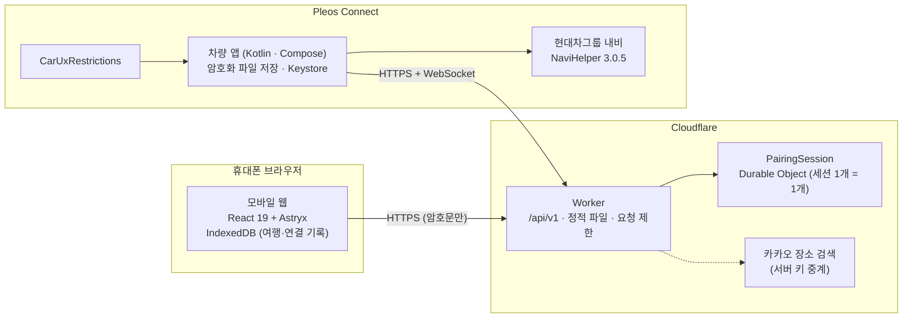
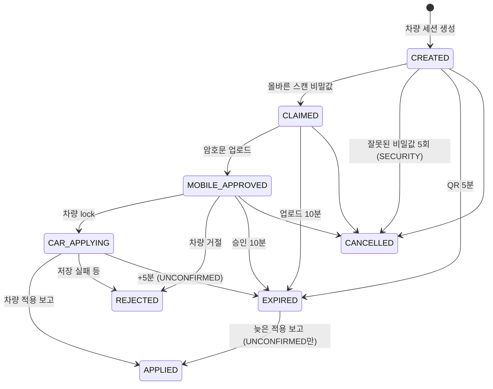

# 02 기술 구조

## 1. 구성



| 경로 | 내용 |
|---|---|
| `schema/` | 언어 중립 계약: `trip-transfer.v1.schema.json`(zod에서 생성), `pairing-protocol.v1.json`(상태·유효시간·오류 코드), fixture 20개, 암호화 벡터 |
| `packages/shared` | 전송 스키마(zod), 정규화 JSON·해시, 무결성 검사, WebCrypto E2E, 세션 상태 전이(순수 함수), 샘플 여행 |
| `packages/worker` | Worker 라우터, `PairingSession` DO, 카카오 프록시, 웹 정적 파일 제공 |
| `packages/web` | 여행 편집기, 연결 화면(`/c`), 개인정보 안내 |
| `car/core-trip` | (JVM) 전송 DTO·파서, 정규화 해시, 재검증기, 결정표, 다음 목적지, 장소 판정 |
| `car/core-pairing` | (JVM) E2E 암호화(java.security), 차량 상태 머신 |
| `car/app` | Compose UI, ViewModel, OkHttp 클라이언트, 저장소, 주행 잠금, 내비 게이트웨이 |

## 2. 연결 프로토콜

### QR 내용

```
https://<host>/c#v1.<sid>.<scanSecret>.<fp>
```

- `sid`, `scanSecret`: 각각 128bit 난수(base64url 22자). `fp`: 차량 임시 공개키 SHA-256의 앞 16바이트.
- 모두 **fragment(`#` 뒤)**에 있어 브라우저가 서버로 보내지 않습니다. 웹은 읽자마자 `history.replaceState`로 주소창·기록에서 지웁니다.
- 여행·주소·비밀번호·장기 토큰은 들어 있지 않습니다. URL은 약 115바이트, QR 버전 7(ECC M)입니다.

### API (`/api/v1`, 토큰은 Authorization 헤더로만)

| 요청 | 호출자 | 역할 | 반복 호출 |
|---|---|---|---|
| `POST /sessions` | 차량 | 세션 생성 (`carPub`, 앱 버전, 지원 스키마 버전) → `sid`, `scanSecret`, `carToken`, 만료 시각 | — |
| `GET /sessions/{sid}/events` | 차량 | WebSocket 상태 푸시 (hibernation, 연결 1개) | 재연결 시 이전 연결 종료 |
| `GET /sessions/{sid}` | 차량 | 상태 스냅샷 | 안전 |
| `POST /sessions/{sid}/claim` | 휴대폰 | 스캔 비밀값 소진 + 휴대폰 공개키 등록 → `mobileToken`, `carPub` | 2회차부터 409 |
| `PUT /sessions/{sid}/payload` | 휴대폰 | 암호문 업로드 (최대 96 KiB) | 같은 내용 200, 다른 내용 409 |
| `GET /sessions/{sid}/payload` | 차량 | 암호문 받기 | 안전 |
| `POST /sessions/{sid}/lock` | 차량 | 적용 시작 (이후 휴대폰 취소 불가) | 안전 |
| `POST /sessions/{sid}/result` | 차량 | 결과 보고 (`APPLIED`/`REJECTED` + 결과 코드) | 같은 결과 안전 |
| `POST /sessions/{sid}/cancel` | 양쪽 | 취소 | 안전 |
| `GET /sessions/{sid}/status` | 휴대폰 | 상태 조회 | 안전 |
| `GET /places/search?q=` | 휴대폰 | 카카오 장소 검색 (키 없으면 503 → 직접 입력) | — |

### 상태 전이 (`packages/shared/src/protocol.ts` `transition`)



- 종료 상태가 되면 암호문과 비밀값 해시를 즉시 지우고, 상태·결과·시각만 남긴 묘비를 10분 뒤 `deleteAll`로 지웁니다.
- 유효시간은 서버 상수이며 시험에서는 1초로 줄여 실제 시간으로 만료를 확인합니다.
- Durable Object는 한 번에 요청 하나만 처리하므로 1회 claim과 상태 전이가 원자적입니다.

### 인증·암호화·확인 코드

| 항목 | 방식 |
|---|---|
| 차량 인증 | 생성 시 받은 `carToken`(256bit). 서버는 SHA-256만 저장, 상수 시간 비교 |
| 휴대폰 인증 | claim 성공 시 `mobileToken`(256bit). 세션당 휴대폰 1대 |
| 차량 키 검증 | 휴대폰이 claim 응답의 `carPub` 지문을 QR의 `fp`와 비교 → 다르면 "연결 대상이 일치하지 않아요" |
| 종단간 암호화 | P-256 ECDH → HKDF-SHA256(salt = SHA-256("handoff/v1\|"+sid), info = 라벨‖0‖carPub‖mobilePub) → AES-256-GCM. AAD에 sid·스키마 버전 포함 |
| 확인 코드 | 같은 ECDH 결과에서 HKDF("confirm")로 4바이트 → 10⁶으로 나눈 나머지 6자리. 서버가 키를 바꿔치기하면 두 화면 코드가 달라짐 |
| 교차 검증 | `schema/fixtures/crypto/vectors.json`의 고정 키로 TS·Kotlin이 같은 공유 비밀·키·코드·암호문을 내는지 시험 |

X25519 대신 P-256을 쓴 이유: Android minSdk 28에서 추가 라이브러리 없이 지원되고, 브라우저 WebCrypto도 모두 지원합니다.

### 요청 제한·전송 보안

- Workers Rate Limiting: IP당 60초에 세션 생성 10, claim 20, 전체 120, 검색 30. 세션별 claim 5회.
- TLS 1.2 이상, HSTS. 차량 release 빌드는 평문 통신 금지, dev 빌드만 `10.0.2.2`/`localhost` 평문 허용.
- 로그에는 요청 본문·토큰·검색어를 남기지 않습니다.

## 3. 여행 전송 스키마 v1

zod 스키마(`packages/shared/src/tripTransfer.ts`)가 기준이며 JSON Schema는 생성물입니다. 모든 객체는 `additionalProperties: false`이고, 메모·예약번호·결제·비밀번호 칸은 아예 없습니다.

| 영역 | 필드 |
|---|---|
| 식별 | `tripId`(UUID, 불변), `revision`(내용이 바뀔 때만 +1), `updatedAt` |
| 기본 | `name`, `timezone`(IANA), `startDate`, `endDate` |
| 출발·귀가 | `firstDay`(DEPART_ORIGIN+출발시각 \| ARRIVE_FIRST_STOP+도착시각+준비분), `origin`/`finalDestination`(HOME \| PLACE), `home`(동의할 때만) |
| 장소 | `placeRef`, 이름, 주소, `latE7`/`lonE7`(정수), 종류, 출처(KAKAO/MANUAL+외부ID), `naviPoi?`, 영업시간(UNKNOWN \| USER_ENTERED) |
| 방문 | 체류·준비 분, 중요도, 희망시각, 고정(시각·종류), 날짜/시간 변경 허용, `unassignedReason`(미배정 사유) |
| 일차 | `dayIndex`, `date`, `departTime`, `endBy`, `visitOrder`, `legs`(구간 n+1개, null은 미확인), `lodgingPlaceRef` |

- **정규화 해시**: 키를 UTF-16 순으로 정렬, 공백 없음, 정수만, 문자열은 `JSON.stringify`와 같은 이스케이프 → SHA-256 base64url. Kotlin(`CanonicalJson.kt`)이 한글·이모지·제어문자·짝 없는 서로게이트까지 같은 값을 내는지 fixture로 확인합니다.
- **무결성 오류 코드**(이것만 거절 사유): `SCHEMA`, `UNSUPPORTED_VERSION`, `DATE_RANGE`, `DAY_COUNT_MISMATCH`, `DAY_SEQUENCE`, `DUPLICATE_REF`, `UNKNOWN_PLACE_REF`, `UNKNOWN_VISIT_REF`, `DUPLICATE_ASSIGNMENT`, `LEGS_LENGTH`, `UNASSIGNED_REASON_MISMATCH`, `HASH_MISMATCH`, `TOO_LARGE`. 검사 순서까지 계약이며 TS·Kotlin이 fixture 20개에서 같은 첫 코드를 냅니다.
- **버전 협상**: 차량이 세션 생성 때 지원 버전을 알리고, 서버는 지원하지 않는 버전 업로드를 거절합니다(422). 휴대폰은 "차량 앱 업데이트가 필요해요"를 보여 줍니다.

## 4. 차량 앱

### 저장

- `filesDir/{real|demo}/trips/<localId>.trip` — 여행 하나당 파일 하나, `AtomicFile`로 쓰고 Android Keystore AES-256-GCM 키로 암호화(`SecureBox`).
- 읽을 수 없는 파일은 지우거나 덮지 않고 개수만 알립니다.
- `allowBackup=false`, 데이터 추출 규칙에서 파일·환경설정 모두 제외.
- 실제 데이터와 시연 데이터는 폴더가 다릅니다.
- `LocalTrip` = 받은 계획(수정하지 않음) + `CarOverlay`(내비 장소 연결, 내비 '집', 출발지 재지정, 방문 기록) + `ImportMeta`(원본 ID, 버전, 계획 해시).

### 재검증 (`TripValidator`, 24-4)

결과는 충돌(CONFLICT) / 확인 필요(UNCERTAIN) / 정보(INFO)로 표시만 하고 계획은 고치지 않습니다.

| 규칙 | 판정 |
|---|---|
| 좌표 없음 / 국내 범위 밖 / 같은 장소 중복 | 충돌 / 확인 필요 / 정보 |
| 날짜 없는 고정 일정 | 충돌 |
| 하루 타임라인: 출발 + 이동 + 준비 → 고정 시각보다 늦으면 | 충돌 ("고정 13:00에 늦어요, 예상 13:20") |
| 이동시간 없음 | 확인 필요 ("충돌 확인 불가") — 0분으로 계산하지 않음 |
| 고정 일정 앞 구간 이동시간 없음 | 확인 필요 |
| 영업정보 미입력 | 확인 필요 ("영업정보 미확인 N곳") |
| 사용자 입력 영업시간: 휴무일·요일·시간대 | 충돌 ("사용자 입력 기준") |
| 1~N−1박 숙소 없음 | 확인 필요 (다음 날 출발지를 알 수 없음) |
| 첫날 도착 기준: 첫 구간 이동시간 없음 / 전날 출발 필요 | 확인 필요 / 충돌 |
| 집 출발·귀가인데 집 위치 없음 | 확인 필요 (내비 '집' 불러오기 제공) |
| 목표 귀가 시각(`endBy`) 초과 | 충돌 |
| 지난 여행 (여행 시간대 기준 오늘) | 정보 ("렌터카·공용 차량이면 삭제") |

### 가져오기 상태 머신 (`CarHandoffMachine`)

순수 리듀서 `(상태, 이벤트) → (상태, 효과)`이고 ViewModel이 효과(세션 생성, 코드 계산, 암호문 받기, 저장, 결과 보고, 취소, 연결 해제)를 실행합니다. 주요 규칙:

- 차량 승인(Approve) 없이는 저장하지 않습니다.
- 요약 단계의 "불러오지 않기"는 취소가 아니라 답입니다(`REJECTED/USER_DECLINED`). 휴대폰은 "차량에서 불러오기를 취소했어요"를 봅니다.
- 저장(커밋) 중에는 서버의 만료·취소 푸시가 끼어들지 못합니다. 결과는 먼저 파일로 남긴 뒤 보내고, 실패하면 다음 실행 때 다시 보냅니다.
- 카운트다운은 서버가 알려 준 남은 시간과 단조 시계로 계산합니다(차량 시계가 틀려도 영향 없음).

### 다음 목적지 안내 (24-1 11단계)

1. 오늘 날짜(여행 시간대 기준)의 일차에서 방문하지 않은 첫 장소 → 없으면 그날 숙소 → 마지막 날은 귀가지.
2. 내비가 이미 다른 곳으로 안내 중이면 "현재 경로를 바꿀까요?"를 먼저 묻습니다.
3. `NaviHelper.requestRoute(RouteInfo(좌표, 이름, poiId?, 주소, provider?))`.
4. 내비는 처음에 빈 목적지를 보낸 뒤 경로 화면을 거쳐 확정합니다. 앱은 최대 30초 동안 목적지를 다시 조회해 **같은 POI이거나 150m 이내**일 때만 "안내를 시작했어요"를 표시하고, 그 내비 장소를 오버레이에 연결해 둡니다.
5. 다른 곳이 확정되면 거리를 보여 주고 사용자가 고르게 합니다. 응답이 없으면 [내비에서 찾기](`SearchPlace("이름 시·군")`) → 앱으로 돌아왔을 때 거리로 판정(150m 자동, 2km까지 확인, 그 이상 경고).
6. 카카오·수동 ID는 내비 `poiId`로 쓰지 않습니다. 요청은 사용자가 버튼을 눌렀을 때만 보냅니다(실제 목적지를 바꾸기 때문).

에뮬레이터(Pleos Connect 2.1.0)에서 확인한 사실:
- 좌표와 이름만 담은 `RouteInfo`로 실제 경로 안내가 시작됩니다.
- 확정 응답은 `poiId`·`poiProvider`가 빈 값이고 좌표와 이름은 들어 있습니다.
- HOME 즐겨찾기는 조회되지만 주소·이름이 빈 값일 수 있습니다. 이 경우 화면에는 "내비 즐겨찾기 '집'"으로 표시합니다.

### 주행 잠금

`CarUxRestrictionsManager`의 `isRequiresDistractionOptimization`이 참이거나 상태를 모르면 잠금으로 봅니다. 잠금 중에는 QR·요약·안내 요청·삭제 버튼을 숨기거나 비활성화합니다. 시험용 에뮬레이터는 user 빌드라 VHAL 주입이 막혀 있고 Virtual Console도 `emulator_inactive`였습니다. 그래서 주행 화면은 에뮬레이터·debug 빌드 전용 시연 스위치로 검증했습니다. 실제 `CarUxRestrictions` 경로는 cold boot 후 Virtual Console로 추가 확인해야 합니다.

## 5. 모바일 웹

- 계정이 없습니다. 여행은 IndexedDB(`trips`)에만 저장하고, `navigator.storage.persist()`를 요청하며, JSON 백업 내보내기·가져오기를 제공합니다.
- 연결 기록(`pairing`)에는 추출 불가 CryptoKey·토큰·보낸 암호문이 들어 있어 새로고침 후에도 같은 내용을 다시 보낼 수 있습니다. 세션이 끝나면 지우고, 24시간 지난 기록은 자동으로 정리합니다.
- 전송 데이터는 화이트리스트 매퍼 `toTransfer(doc, includeHome)`로만 만듭니다. 저장된 여행에 다른 필드가 섞여 있어도 스키마 검증에서 거절됩니다(단위 시험).
- revision은 계획 해시가 바뀔 때만 올립니다. 집 주소는 계획 해시에 넣지 않습니다.
- Astryx Neutral 테마를 쓰고, 원격 Google Fonts 대신 시스템 글꼴을 씁니다. CSP는 `default-src 'self'`입니다.

## 6. 빌드와 시험

| 대상 | 명령 | 결과 (2026-11-05) |
|---|---|---|
| shared | `npm test -w @tteonaljido/shared` | 41개 통과 |
| worker | `npm test -w @tteonaljido/worker` (workerd에서 실행) | 12개 통과 |
| web | `npm test -w @tteonaljido/web` | 10개 통과 |
| car | `cd car && ./gradlew test` | 43개 통과 |
| 서버 스모크 | `npx tsx tools/pairing-smoke.mts http://localhost:8787` | 통과 |
| 브라우저 E2E | `npx tsx tools/e2e-mobile.mts` | 11개 항목 통과 |
| 에뮬레이터 E2E | `npx tsx tools/e2e-car.mts emulator-5580` | 15개 항목 통과 |

툴체인: AGP 9.2.1(내장 Kotlin 2.2.10), Gradle 9.4.1, compileSdk 37 / targetSdk 34 / minSdk 28, Compose BOM 2026.09.00, NaviHelper 3.0.5. Node 22.13+, wrangler 4.151.3, React 19.3.1, Vite 7.3.7, Astryx 0.7.7.

## 7. 배포

- Worker 하나가 API와 웹 정적 파일(`packages/web/dist`, SPA)을 함께 제공합니다. 출처가 같아 CORS가 필요 없습니다.
- 정적 파일 보안 헤더는 `public/_headers`에 있습니다(CSP, no-referrer, Permissions-Policy, HSTS).
- 카카오 키는 `wrangler secret put KAKAO_REST_KEY`로 넣습니다. 없으면 검색이 503을 내고 웹은 직접 입력으로 안내합니다.
- 차량 prod 빌드의 서버 주소는 `-Ptteonaljido.prodOrigin=https://…`로 지정합니다.
- 익명 심사를 위해 실명이 드러나지 않는 서브도메인을 씁니다.

## 8. 성능·자원

- QR은 zxing 인코더만 씁니다(카메라 없음). 폴링은 화면이 보일 때만 하고(휴대폰 2초, 차량 5초 보조), 실시간 갱신은 WebSocket으로 받습니다.
- 백그라운드 작업은 세션이 끝나면 모두 취소합니다.
- RAM 400MB 이하·응답 0.25초 기준은 M7에서 측정할 예정입니다.

## 9. 향후 설계: 지속 동기화 (미구현)

현재 버전에는 **구현되어 있지 않습니다.** 차량과 휴대폰을 계속 맞추려면 다음이 필요합니다.

| 항목 | 설계 방향 |
|---|---|
| 동의와 범위 | 여행 단위로 "이 차와 계속 맞추기"를 별도 동의. QR 불러오기와 다른 버튼 |
| 연결 수단 | 일회용 세션 대신 기기 쌍 키(양쪽에 장기 키, 서버는 계속 암호문만) |
| 버전 | 양쪽이 `revision`과 마지막 동기화 시점 기록 |
| 동시 수정 | 자동 병합하지 않음. 고정 일정·숙소 변경 충돌은 사용자 선택 |
| 고정 일정 보호 | 반대쪽 변경이 고정 일정을 움직이면 항상 확인 |
| 해제·삭제 | 어느 쪽에서든 해제하면 서버 키 폐기, 차량 여행 삭제 여부를 묻기 |
| 공용·렌터카 | 반납 전 해제·삭제 안내, 일정 기간 미사용 시 자동 해제 |
