# 떠날지도 — 접수양식 02 앱 프로젝트 소개 (초안)

> 익명 심사 자료입니다. 성명·연락처·이메일·소속·계정명은 넣지 않습니다. 01 참가신청서, 03 동의서, 04 서명은 대표자·팀원이 직접 작성합니다.
> 이 파일이 원본이며 `tools/fill_form.py`로 공식 DOCX에 옮깁니다. `##` 아래 내용이 그 번호의 답변 칸에 들어갑니다. 쓸 수 있는 서식: `### 소제목`, `- 글머리표`(두 칸 들여 쓰면 하위), `**굵게**`, `` `API명` ``, `> 요약`, `| 표 |`(다음 줄 `{cols: 30/70; caption: 설명}`으로 열 너비 %와 "표 N." 제목), ``(`{70%}`로 좁게). 빈 줄이 문단을 나눕니다. 그림의 원본은 `submission/figures/src`(three.js·HTML)입니다.
> 사업 지표는 모두 목표값이고 실적이 아닙니다. 에뮬레이터 값은 Pleos Connect Emulator에서 서명된 release APK로 잰 값입니다. 기준일 2026-11-14(M64).

## 앱명
떠날지도

## 1. 앱 한 줄 소개
가고 싶은 곳만 담으면 여행 전체의 **날짜별 동선을 자동으로** 짜 주고, 차에 타서 **QR 한 번**으로 옮기면 **현대차 내비가 실제 시간·거리를 다시 재며** 순서대로 안내하는 차량용 여행 도우미입니다.

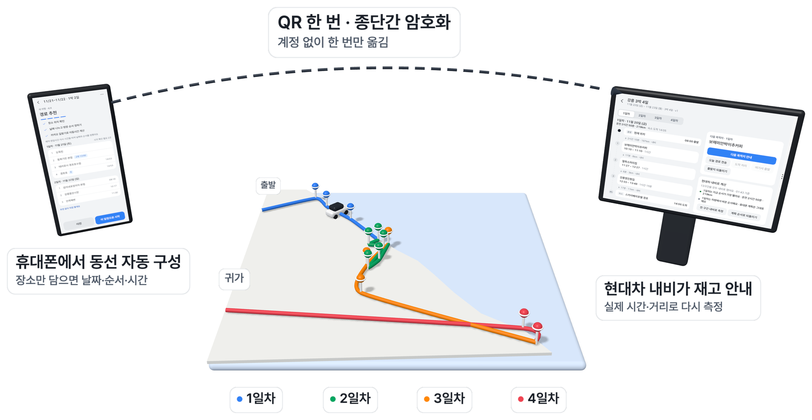

## 2. 기획 배경
> **누구의 불편인가** — 국내에서 1~4일 자차·렌터카로 여행하는 가족·커플·친구 여행자, 특히 식당·체험 예약이 있는 촘촘한 여행입니다.

### 여행자가 겪는 세 가지 불편
- **① 동선 짜기가 가장 오래 걸립니다.** 가고 싶은 곳을 고르는 일은 쉽지만, 고른 장소를 날짜별로 나누고 효율적인 순서로 정하는 일은 오래 걸립니다. 이 일을 건너뛰면 동선이 비효율적이 되어 여행 시간의 많은 부분을 이동에 씁니다.

- **② 예약에 맞춰 언제 떠나야 하는지 모릅니다.** 여행 계획 앱은 장소를 직선으로 잇고 이동시간을 어림하게 둡니다. 여러 날 여행은 예약·숙소·귀가가 얽혀 있어 한 곳이 늦으면 뒤 일정이 함께 무너집니다.

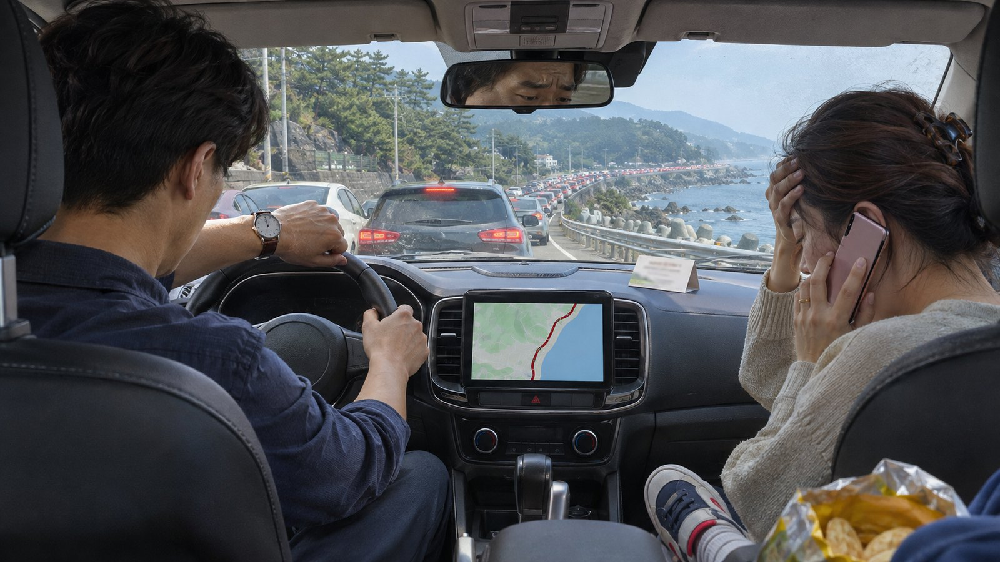{72%}

- **③ 차에 타면 처음부터 다시입니다.** 내비는 '지금 목적지'만 알고 '여행 전체'는 모릅니다. 목적지를 하나씩 다시 검색하는 동안 운전석에서 휴대폰을 만지게 되고, 화면 미러링·계정 연동은 렌터카·공용차에서 쓰기 어렵고 집 주소가 차에 남을까 걱정됩니다.

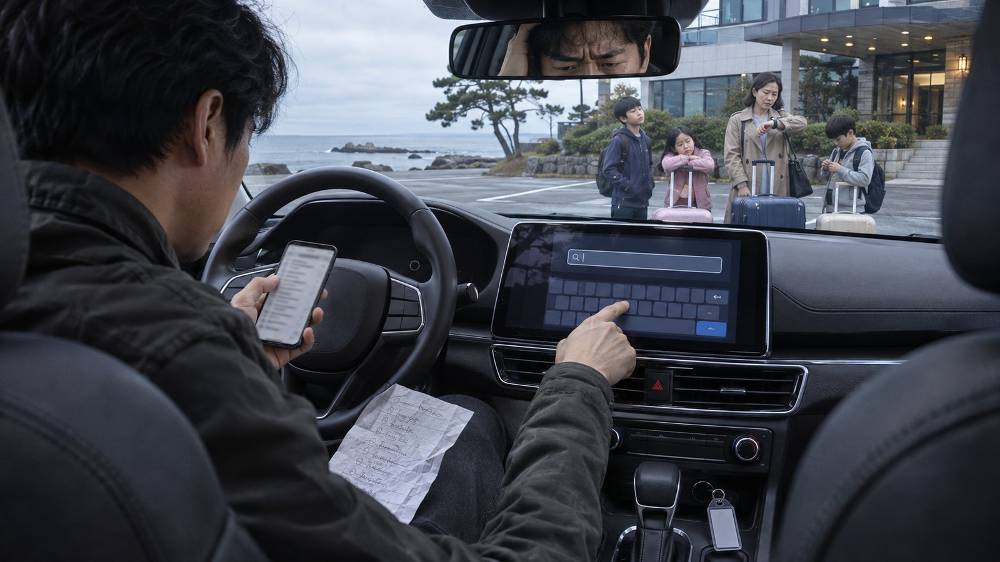{72%}

### 해결 방향
- **휴대폰:** 장소만 담으면 동선이 자동으로 짜입니다.
- **옮기기:** 그 여행을 계정 없이 한 번만 암호화해 차로 옮깁니다.
- **차:** 현대차 내비가 실제 시간·거리로 다시 재고 순서를 확인하며 여행 내내 시간을 챙깁니다.

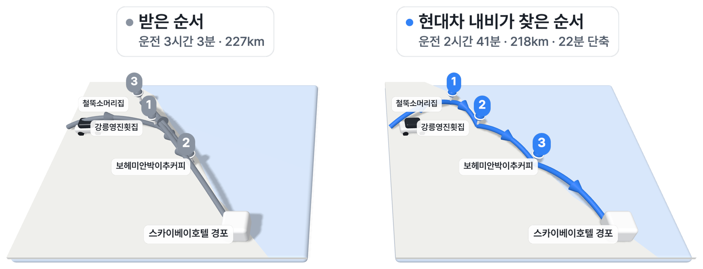

## 3. 앱 주요 기능 및 차량 특화 요소
### 휴대폰 — 장소만 담으면 동선이 짜입니다
- **① 여행 전체 자동 배치:** [경로 추천]이 여행 전체를 한 번에 놓고 날짜와 순서를 함께 정합니다. 적응형 대규모 근방 탐색 + 담금질 최적화 엔진이 다음을 함께 따집니다.
  - 예약은 주차 시간을 더해 10분 전 도착
  - 영업시간·쉬는 날, 식사 시간대, 식사 뒤 카페, 숙소 입실·퇴실
  - 이동시간은 카카오모빌리티 길찾기 예상값으로 채웁니다
- **② 예약 여유 · 늦게 출발하기:** 예약 앞에 '12:35 출발 · 1시간 30분 여유'처럼 떠날 시각을 붙이고, 1시간 넘게 남으면 숙소 퇴실 시간 안에서 '오전 11:00에 출발해도 돼요'를 제안합니다.

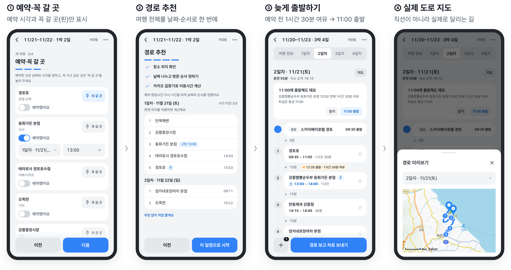

### 차로 옮기기 — 계정 없이 한 번만, 안전하게
- **③ 일회용 QR:** 주차 중 차 화면에 일회용 QR(5분·1회)을 띄우고, 휴대폰으로 찍어 양쪽의 6자리 확인 코드를 맞춥니다. 여행은 종단간 암호화로 보내 중계 서버도 내용을 볼 수 없고, 전달 뒤 지웁니다. 집 주소는 동의할 때만 보냅니다.
- **④ 차가 다시 검사합니다:** 예약 지각, 빠진 이동시간, 숙소에서 다음 날 출발로의 연결, 귀가, 영업시간을 확인해 '충돌·확인 필요'로 표시하고, 사람이 승인해야 불러옵니다. 계획은 고치지 않습니다.

{85%}

### 차에서 — 현대차 내비가 시간·거리·순서의 기준입니다
- **⑤ 전 구간 내비 측정:** 내비의 예상 조회는 차가 있는 곳에서만 잽니다. 그래서 경유지 경로를 걸고 경유지마다 남은 시간·거리를 읽어 그 차이로 차가 있지 않은 구간까지 잽니다(샘플 13구간을 경로 2번, 약 30초). 잰 값이 휴대폰 예상값을 대신하고, 끝나면 측정 경로를 지웁니다.
- **⑥ 내비 기준 순서 최적화:** 그 날의 모든 구간을 내비로 재서 운전이 10분 이상 짧고 예약·영업시간을 해치지 않는 순서를 제안합니다. 차에서만 바꾸고 언제든 되돌릴 수 있습니다.

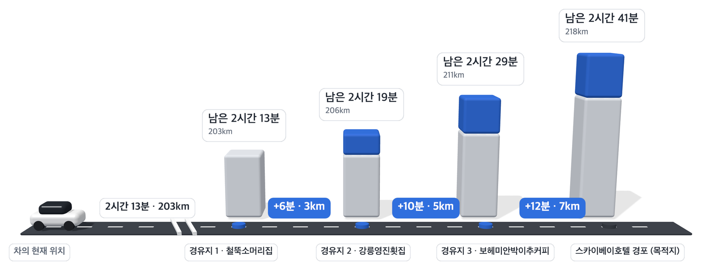
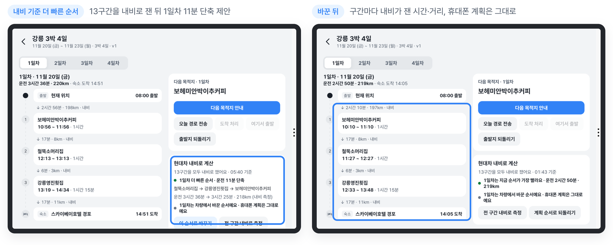

- **⑦ 시간 지킴이:** 내비의 남은 시간으로 하루를 다시 계산해 '13:00 예약까지 여유 135분', '27분 늦을 수 있어요'를 알리고, 늦으면 선택 일정 건너뛰기·미루기를 제안합니다. 내비 도착 알림으로 방문을 자동 체크하고, '오늘 경로 전송'은 남은 장소를 최대 10곳까지 한 번에 내비로 보냅니다.
- **⑧ 차량 신호와 일정의 결합(조회 전용):** 출발 전 점검(안전벨트·문·충전 포트·주행가능거리 대 오늘 남은 거리), 일정 끝 배터리 예상, 2시간 넘게 달리면 경로 위 휴게소와 다음 예약 여유를 함께 보는 쉬어 가기, 전기차 충전·주유 권장.
- **⑨ 주행·정차 맥락:** 주행 중에는 다음 목적지와 상태 한 줄만 남기고 조작을 막습니다(`CarUxRestrictions`). QR·승인·안내·측정은 정차 중 사용자가 누를 때만 동작합니다.

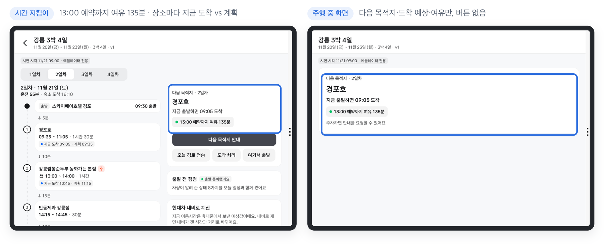

### 차량이기에 가능한 것
> 차 위치에서 내비가 잰 실제 시간·거리, 내비의 남은 시간과 도착 알림, 차량 신호, 주행 규제를 여행 일정과 결합합니다. 휴대폰 앱만으로는 할 수 없는 경험입니다.

{85%}

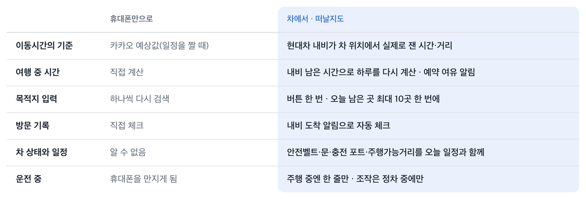

## 4. 주요 사용 시나리오
가족이 **강릉 3박 4일**을 계획하고 다녀오는 흐름입니다.

| 단계 | 장면 |
|---|---|
| 출발 전 (휴대폰) | 지도 앱에서 본 13곳을 '공유'로 담고, 2일차 13:00 식당 예약과 4일차 10:00 바다부채길을 넣은 뒤 **[경로 추천 시작]**을 누르면 날짜·순서와 예상 시간이 채워집니다. 2일차는 예약 전에 1시간 30분이 남아 '오전 11:00에 출발해도 돼요'를 받아들입니다. |
| 출발 당일 (차, 주차 중) | '모바일 여행 불러오기' QR을 휴대폰으로 찍고 두 화면의 6자리 코드를 확인해 보냅니다(집 주소 제외). 차가 다시 검사한 결과를 보고 **[불러오기]**. **[전 구간 내비로 측정]**으로 내비가 모든 구간을 재고, 1일차는 '운전 22분 단축' 순서로 바꿉니다. 출발 전 점검이 뒷좌석 안전벨트를 알려 줍니다. |
| 여행 중 (주행) | **[다음 목적지 안내]**로 현대차 내비가 안내합니다. 주행 중 화면에는 다음 목적지와 '13:00 예약까지 여유'만 보입니다. 길이 막혀 늦을 것 같으면 주차 중 선택 일정 건너뛰기·미루기 제안이 뜹니다. 도착하면 방문이 자동으로 표시되고, 2시간 넘게 달리면 휴게소를 권합니다. |
| 마무리 | 마지막 날은 내비 '집'으로 귀가합니다. 렌터카라면 반납 전 여행 삭제를 안내합니다. 동승자가 휴대폰에서 일정을 바꿔 다시 보내면 차는 변경 요약을 보여 주고 업데이트할지 고르게 합니다. |
{cols: 20/80}

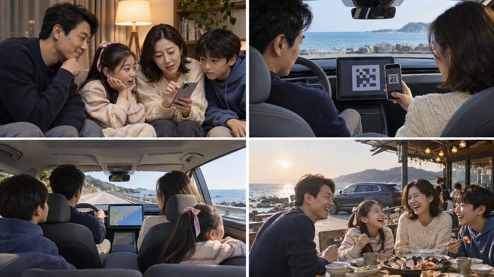{90%}

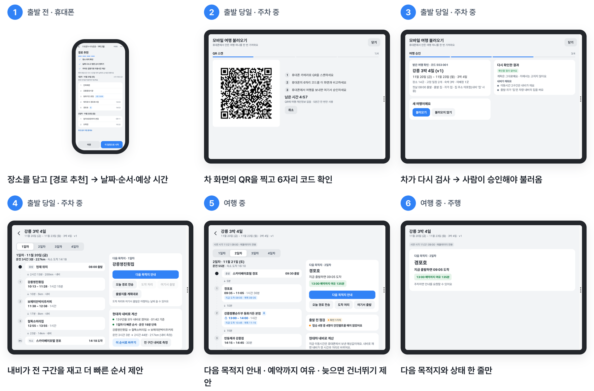

## 5. 개발 계획
> **구현 현황** — 차량 앱·모바일 웹·중계 서버를 모두 구현해 배포했습니다. 서명된 release APK(0.6.0)로 Pleos Connect Emulator에서 QR 불러오기부터 실제 내비 안내·구간 측정·순서 최적화까지 확인했습니다. 시험 548개(Kotlin 212 · TypeScript 336), 휴대폰·차량 E2E, 배포 서버와의 실제 연동 15항목이 통과합니다.

### 기술 구성
| 구성 | 기술 |
|---|---|
| 차량 앱 | Pleos Connect(Android Automotive) 앱, Kotlin · Jetpack Compose, minSdk 28 / targetSdk 34. Pleos Connect 공식 디자인 명세의 컴포넌트·토큰·Asta Sans를 쓰고 주간·야간을 지원합니다. |
| 내비 연동 | NaviHelper 3.0.5 — 사용 API는 표 1 |
| 차량 신호 | Vehicle SDK 2.3.2(모두 조회) — EvBattery·Fuel·Odometer(에너지·주행가능거리), Gear·DrivingMode, Door·Seat(문·착좌·안전벨트), Safety(출력 제한·워셔액 등). 지원 여부는 실행 중에 확인합니다. AAOS `CarUxRestrictions`로 주행 규제를 따릅니다. |
| 권한 | INTERNET, NAVI_ROUTE·NAVI_ROUTE_SEARCH·NAVI_CUSTOM_MAP, 읽기 전용 CAR_ENERGY·CAR_DRIVE·CAR_SAFETY·CAR_DOORS·CAR_SEATS, 측정 중에만 쓰는 FOREGROUND_SERVICE. **차량 제어 권한과 비공개 권한은 쓰지 않습니다.** |
| 휴대폰 | 설치 없이 QR로 열리는 모바일 웹(React 19), 여행은 휴대폰 안에만 저장합니다. 여행 전체 최적화 엔진은 의존성 없는 공용 TypeScript 모듈입니다. |
| 중계 서버 | Cloudflare Workers·Durable Objects로 세션 하나를 원자적으로(5분·1회) 처리하고, P-256 ECDH·HKDF·AES-256-GCM 종단간 암호화를 씁니다. 카카오 키는 서버에만 두고 좌표만 전달하며 저장·기록하지 않습니다. |
{cols: 16/84}

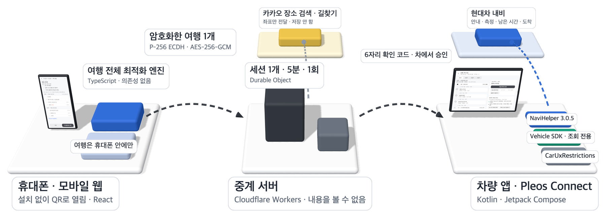

### 기능별로 쓰는 Pleos SDK·API
| 기능 | 쓰는 Pleos SDK·API | 하는 일 |
|---|---|---|
| 다음 목적지 안내 | `requestRoute` | 다음 장소로 현대차 내비 안내를 시작합니다 |
| 오늘 경로 전송 | `requestRouteWithWaypoints` | 남은 장소를 최대 10곳까지 경유지로 한 번에 보냅니다 |
| 전 구간 내비 측정 | `requestRouteWithWaypoints` · `getWaypointInfo` · `cancelRoute` | 경유지 경로를 걸고 경유지별 남은 시간·거리의 차이로 구간 값을 잰 뒤 측정 경로를 지웁니다 |
| 내비 기준 순서 최적화 | 위 측정값 | 운전이 10분 이상 짧고 예약·영업시간을 해치지 않는 순서를 제안합니다 |
| 1일차 첫 구간 | `requestTrip` · `getCurrentLocationInfo` | 차 위치 기준 예상 시간·거리·도착 시 배터리를 받습니다 |
| 시간 지킴이 · 도착 예정 | `onDrivingInfo` · `getWaypointInfo` · `getDestinationInfo` | 내비의 남은 시간으로 하루를 다시 계산하고 다음 장소 도착 예정을 보여 줍니다 |
| 자동 방문 체크 | `onDestinationArrived` · `onWayPointArrived` | 도착 알림으로 방문을 표시합니다 |
| 정체 알림 | `getRouteStateInfo` | 경로의 정체·사고 상황을 보여 줍니다 |
| 귀가 | `getBookmarkInfo` | 내비 '집'으로 귀가 경로를 겁니다(집 좌표는 서버로 보내지 않음) |
| 장소 검색 · 근처 충전소 | `requestNavigationScreen` | 내비의 장소 검색·근처 충전소 화면을 엽니다 |
| 출발 전 점검 | Vehicle SDK `Door` · `Seat` · `Gear` · `EvBattery` · `Odometer` | 문·안전벨트·충전 포트를 확인하고 주행가능거리를 오늘 남은 거리와 견줍니다 |
| 쉬어 가기 | `Gear` · `Odometer` + `getTBTInfo` · `onDrivingInfo` | 연속 운전 시간·거리, 경로 위 휴게소, 다음 예약 여유를 함께 보고 쉬어 갈지 권합니다 |
| 충전 · 주유 권장 | `EvBattery` · `Fuel` · `Odometer` + `requestTrip` | 일정 끝 배터리를 예상하고 충전·주유를 권합니다 |
| 주행 중 화면 | AAOS `CarUxRestrictions` | 주행 중에는 한 줄만 남기고 조작을 막습니다 |
{cols: 21/37/42; caption: Pleos SDK·API와 기능의 연결(NaviHelper 3.0.5 · Vehicle SDK 2.3.2, 모두 조회·안내 요청만 사용)}

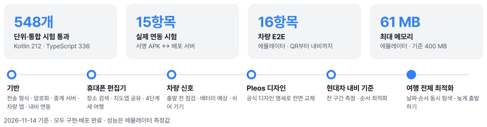

### 2차 PT까지
- 실제 휴대폰 QR 인식
- 실차에서 내비가 받는 경유지 수·주행 규제·차량 신호 검증
- 성능 측정, 시연 다듬기

## 6. 기대효과 및 발전 가능성
### 타깃 고객
국내 1~4일 자차·렌터카 여행자(가족·커플·친구), 예약이 있는 촘촘한 여행. 계정 없이 쓰고 지우는 구조라 **렌터카·카셰어링 이용자**로 바로 넓힐 수 있습니다.

### 사용자 가치
- **동선 짜는 시간을 줄입니다:** 장소만 담으면 자동 배치
- **이동에 쓰는 시간을 줄입니다:** 내비가 잰 값으로 더 빠른 순서 제안
- **예약에 늦지 않게 합니다:** 떠날 시각과 여유를 미리, 여행 중에도 다시 계산
- **차에서 목적지를 다시 입력하지 않게 합니다:** 개인정보는 필요한 만큼만 한 번 옮깁니다

### 목표 지표
> 출시 후 **목표값**이며 실적이 아닙니다.

| 지표 | 출시 3개월 목표 |
|---|---|
| 설치 | 500 |
| MAU | 200 (월 활성 40% 가정) |
| D30 재사용률 | 20% |
| 불러오기 성공률 | 95% 이상 |
{cols: 30/70}

**함께 재는 값:** 여행 1회 계획에 걸린 시간, 추천 적용 전후 하루 운전 시간, 여행 1회당 내비 수동 검색 횟수, 예약 지각 건수, 더 빠른 순서 수락률.

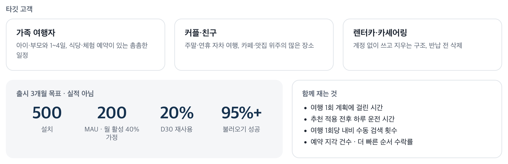

### 다시 쓰게 되는 이유
여행마다 새로 쓰는 구조라 주말·연휴마다 돌아오고, 즐겨찾기와 지난 여행 복제로 두 번째 여행이 더 빨라집니다.

### 확장 계획
- **① 렌터카·카셰어링:** Pleos Fleet API 웹훅으로 받은 차량 상태와 고객의 여행 거리를 합쳐 출고 전에 충전·점검이 필요한 차를 가려내는 준비 점검(수신부·판정 구현, 계약 후 연결), 반납과 연계한 자동 삭제.
- **② 실제 주차 시간 학습:** 내비 안내가 끝난 뒤 시동 종료·안전벨트 해제·문 잠금이 이뤄진 시각을 실제 도착으로 보고 장소 종류별 주차 시간을 시각표에 반영.
- **③ 연계 확대:** 관광·숙박 예약 연계(예약 시각 자동 고정), 충전소·주차장 연계, 외국인 렌터카 여행자를 위한 다국어.

{85%}

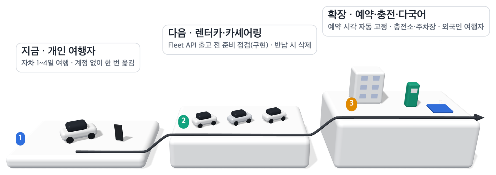

## 7. 참고자료
- **모바일 웹(바로 체험):** https://tteonaljido.tteonaljido-worker.workers.dev/?sample=1 — 아래 QR로 열면 샘플 여행 '강릉 3박 4일'이 열립니다(앱 설치·가입 없음).
- **소개서:** 떠날지도_소개서.pdf(6쪽 — 기능·휴대폰/차량 화면·기술 구조·데이터 흐름·진행 현황), 떠날지도_파이프라인_한장.pdf — 이메일 첨부
- **GitHub 저장소:** 소스·서명 APK(apk/)·문서·실행 화면(docs/evidence) — 비공개 저장소이며 심사용 계정 초대 후 링크 기입
- **시연 영상:** 게시 후 링크 기입

{70%}

## 8. 숏폼 링크
(게시 후 기입)
